<p align="left">
  <a href="README.md"></a>
  <a href="README.jp.md"></a>
</p>

<p align="center">
  
</p>

Backplane es un espacio de trabajo de código abierto para el desarrollo de hardware con agentes. Tu agente edita archivos de KiCad y FreeCAD; tú sigues el trabajo en los visores de placa, esquemático, 3D y mecánico, haces clic en una pieza y hablas sobre ella.

- **Tu agente, tu elección.** Claude, Codex, Grok, OpenCode, Muse Code, Antigravity, Pi y Oh My Pi, en un solo espacio de trabajo.
- **Un fork de KiCad diseñado para agentes.** [Backplane KiCad](https://github.com/BackplaneWorks/Backplane_KiCad) añade APIs IPC de placa y esquemático para que los agentes puedan editar a través de KiCad.
- **Historial de diseño.** Los cambios en placas y esquemáticos se guardan en puntos de control. Vuelve a pasos anteriores, compara versiones y deja comentarios de revisión.
- **Escritorio, web y teléfonos.** La aplicación de escritorio, el navegador y los clientes de iOS y Android se conectan al hub.
- **Licencia MIT.** Creado y mantenido por ingenieros eléctricos.

<p align="center">
  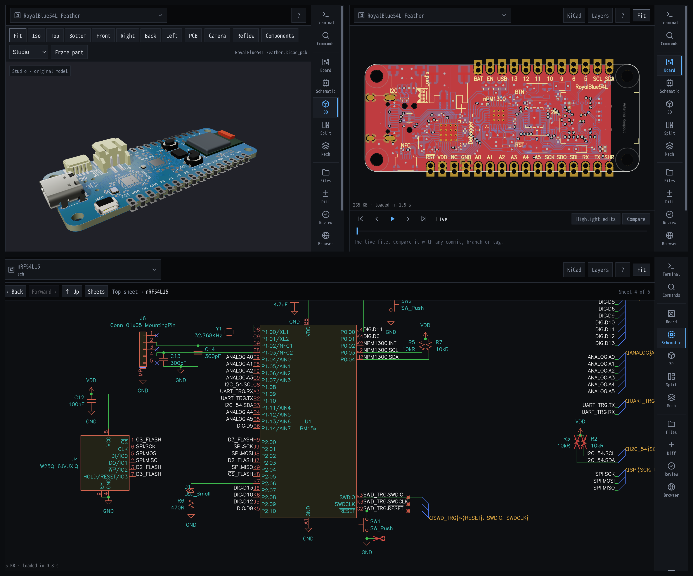
</p>

## Instalación

**Linux**

```sh
{ curl -fsSL https://github.com/BackplaneWorks/Backplane/releases/latest/download/install.sh 2>/dev/null || wget -qO- https://github.com/BackplaneWorks/Backplane/releases/latest/download/install.sh; } | sh
backplane
```

Linux (x64, arm64): el mismo comando de una línea, o `backplane-v<version>-linux-<arch>-native.tar.gz` desde la [última versión](https://github.com/BackplaneWorks/Backplane/releases/latest), descomprimido tal cual (el cliente encuentra los archivos del navegador embebido junto a él).

**macOS (solo Apple silicon: M1 o posterior, macOS 13 o posterior; Backplane KiCad necesita macOS 15 o posterior).** Los Mac con Intel no son compatibles. Usa el mismo comando de una línea, o descarga `backplane-v<version>-darwin-arm64.tar.gz`. El instalador pone **Backplane.app en `~/Applications`**: ábrela desde ahí, Launchpad o Spotlight. La primera vez que abre Documentos, Escritorio o Descargas, macOS pregunta si Backplane puede hacerlo; si dijiste que no, Backplane te indica dónde permitirlo (Configuración del Sistema → Privacidad y seguridad → Archivos y carpetas). Las compilaciones **aún no están notarizadas** (firmadas ad hoc): la descarga del comando de una línea se abre tal cual; para un archivo que descargaste con un navegador y descomprimiste a mano, si macOS rechaza abrirlo, haz clic derecho (o Control + clic) → Abrir → Abrir, o en macOS 15+ ve a Configuración del Sistema → Privacidad y seguridad → «Abrir de todos modos». Consulta [docs/install.es.md](docs/install.es.md#macos-apple-silicon).

**Windows (x64, experimental).** Descarga `backplane-v<version>-windows-x64.zip`, extrae todo el archivo en una carpeta con permisos de escritura y ejecuta `Backplane.exe`.

**Teléfonos.** iOS se instala mediante una invitación de TestFlight; Android utiliza el APK incluido en la publicación. Vincula un dispositivo en Ajustes → Dispositivos → Añadir un dispositivo con un enlace de vinculación, código QR o código corto.

La primera ejecución pregunta en una ventana emergente por los conteos de uso anónimos; vienen activados por defecto y se desactivan desde Ajustes.

Consulta [instalación](docs/install.es.md) para más detalles, configuración en Windows, vinculación de teléfonos y desinstalación. Necesitas una CLI de agente, KiCad para trabajar con placas y esquemáticos, y FreeCAD para diseño mecánico. Antigravity se puede instalar desde Ajustes.

## Inicio rápido

1. Inicia Backplane y añade una carpeta de proyecto: un proyecto de KiCad existente o una carpeta vacía.
2. Elige un agente, modelo y nivel de razonamiento debajo del compositor.
3. Pide algo: «añade un LDO de 3.3 V y desacoplo al esquemático», «revisa el DRC y corrígelo» o «diseña una carcasa para esta placa».
4. Sigue el trabajo en las pestañas Board, Schematic, 3D y Mech. Haz clic en componentes o redes (*nets*) para resaltarlos entre el esquemático y la placa, o referencia una pieza en tu siguiente mensaje.

<p align="center">
  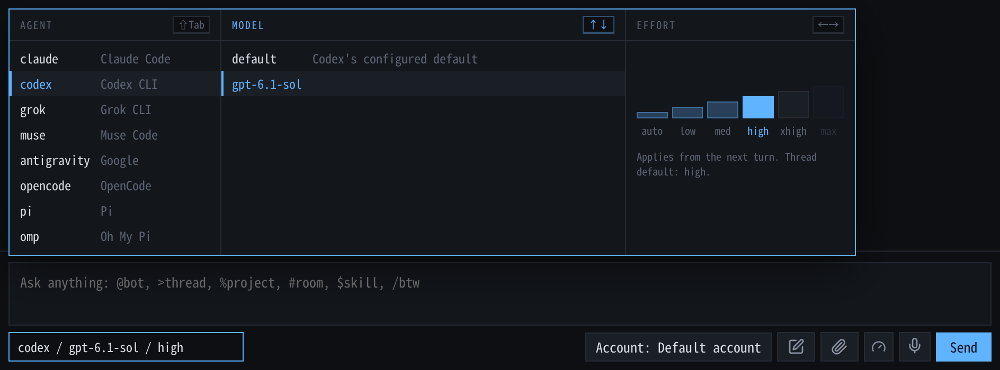
</p>

## CAD

Los visores muestran el diseño a medida que el agente trabaja.

- **Board, Schematic, 3D.** Esquemáticos jerárquicos, controles de capas con el orden y nombres de KiCad, y *cross-probing* entre vistas.
- **Mech.** Visualiza modelos STEP o GLB. Los agentes modelan piezas con scripts de FreeCAD, exportan a STEP y muestran el resultado aquí. Las carpetas solo mecánicas no necesitan un proyecto de KiCad; consulta la [guía rápida de diseño mecánico](docs/mechanical.es.md).
- **Historial y revisión.** Compara versiones, inspecciona cambios por hoja y capa, fija comentarios en una placa o esquemático y ejecuta comprobaciones de BOM, ERC y DRC desde la pestaña Review.
- **Skills.** Las skills de KiCad de [KiStack](https://github.com/BackplaneWorks/kistack) vienen incluidas con la aplicación: esquemático, layout, huellas (*footprints*), BOM y exportaciones de fabricación.
- **Pedidos.** Cuando un diseño tiene un archivo fab, *Buy it* abre un hilo que revisa el diseño y obtiene una cotización. Consulta [pedidos](docs/order.md).

<p align="center">
  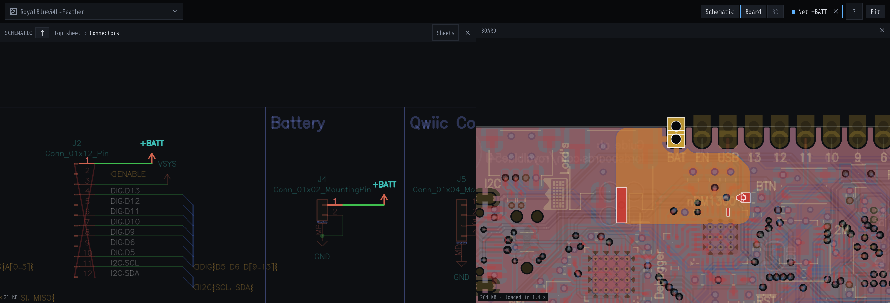
</p>

<p align="center">
  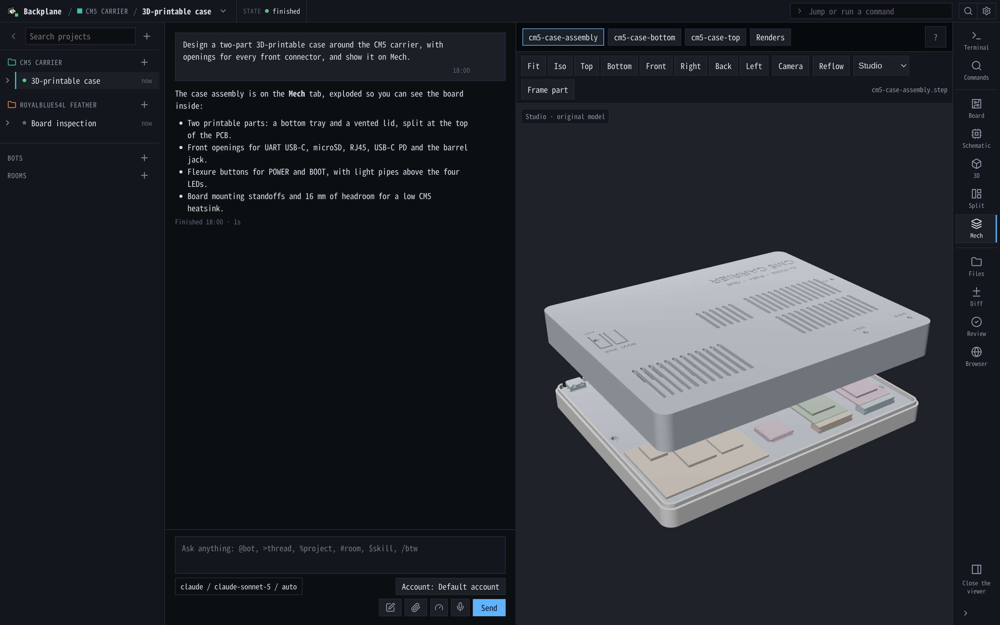
</p>

<p align="center">
  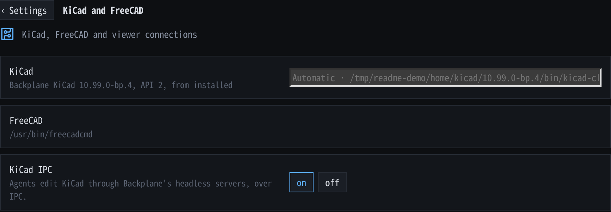
</p>

## Orquestación

Los proyectos contienen hilos (*threads*). Los agentes pueden iniciar subagentes usando otros proveedores, y los hilos pueden enviarse mensajes entre sí. Un «uberbot» puede coordinar bots, proyectos e hilos como tu interfaz principal.

<p align="center">
  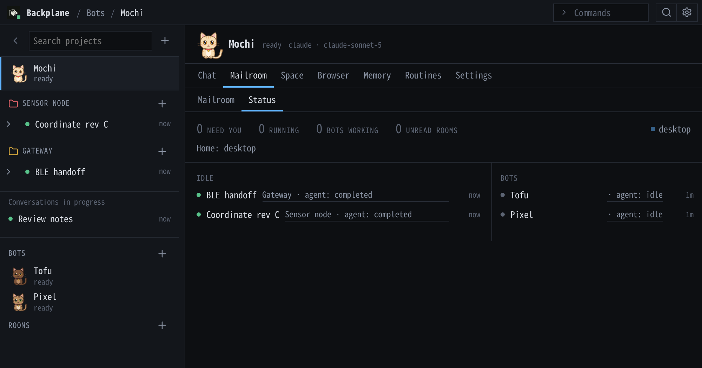
</p>

<p align="center">
  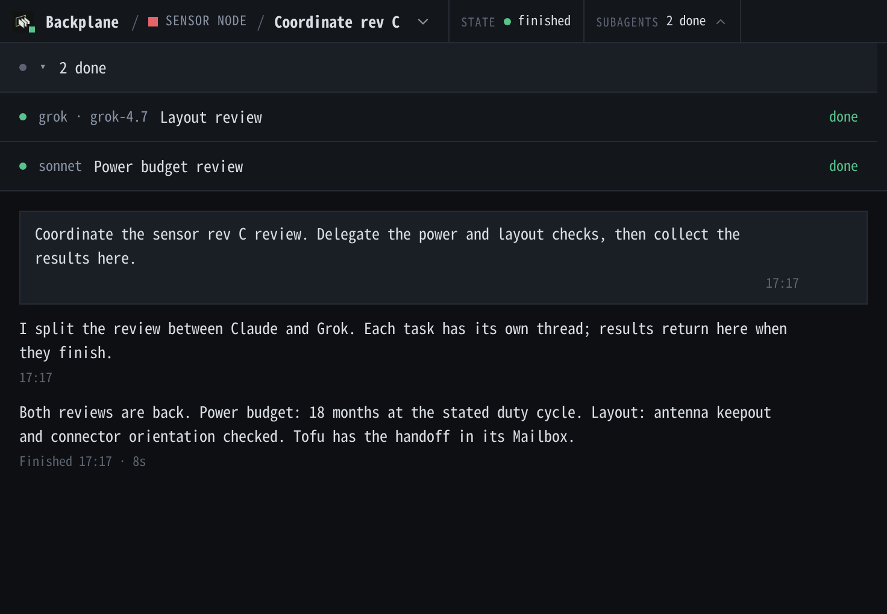
</p>

### Catbots

Los catbots son agentes persistentes para tareas específicas. Tienen webhooks y rutinas, un buzón para comunicarse y un «space» donde el bot sirve una aplicación web persistente.

<p align="center">
  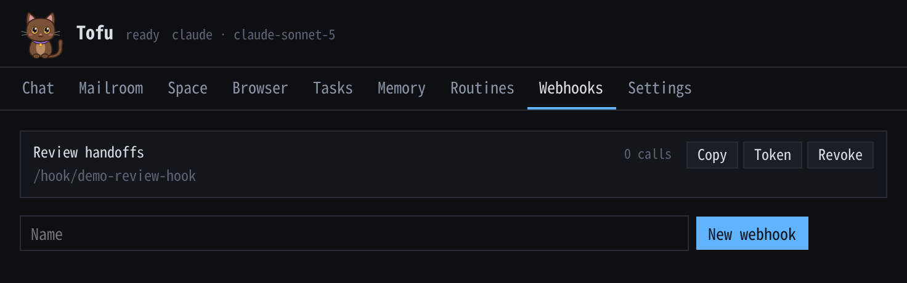
</p>

<p align="center">
  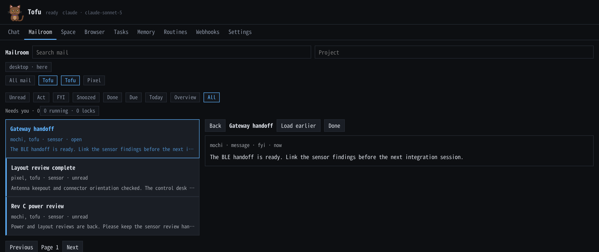
</p>

<p align="center">
  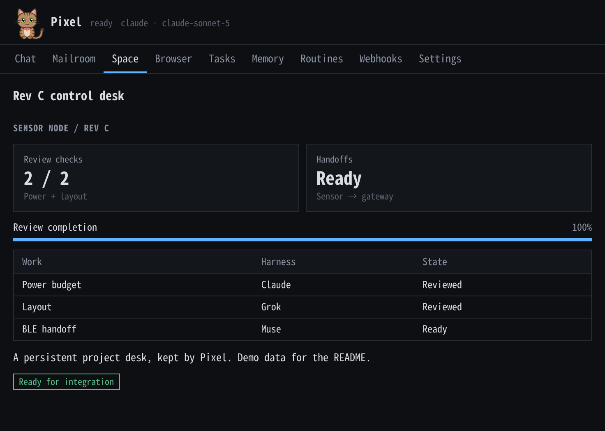
</p>

<p align="center">
  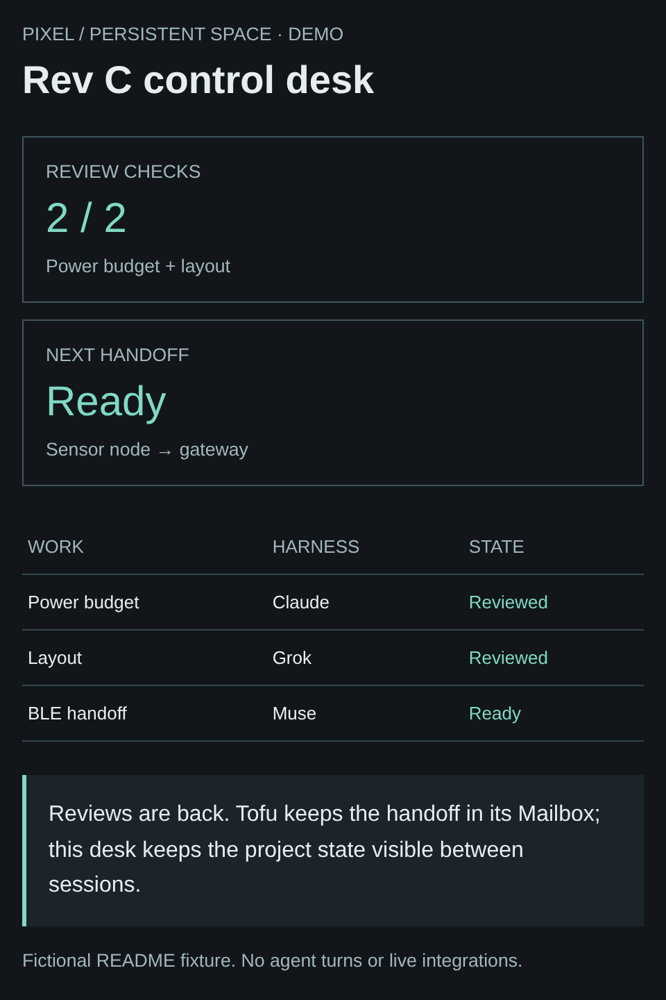
</p>

## Otras funciones

- Enlaces clicables entre hilos, bots y proyectos.

  <p align="center">
    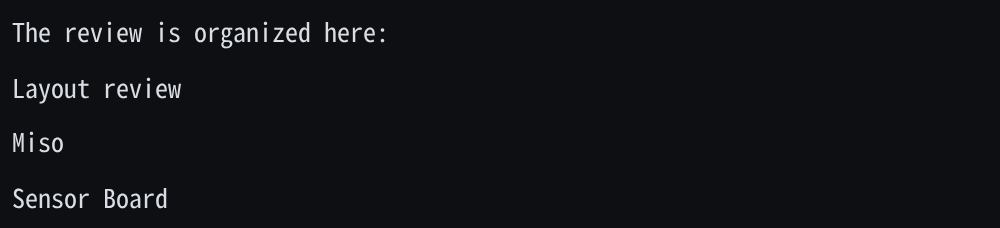
  </p>

- Referencias a otros elementos de Backplane con `>`, `#`, `%`, `@`.

  <p align="center">
    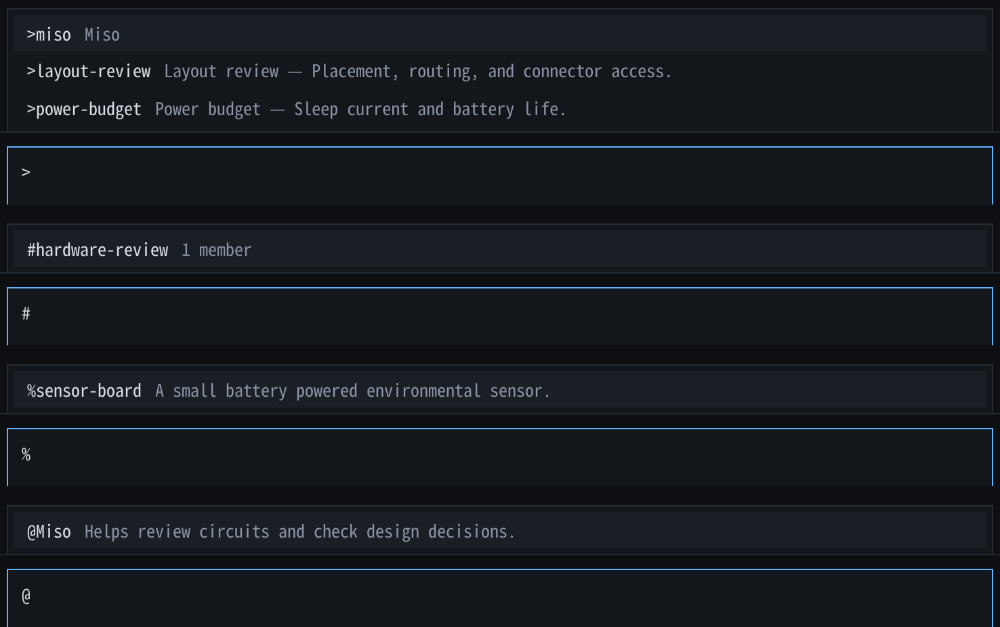
  </p>

- Terminales integradas para TUIs.

  <p align="center">
    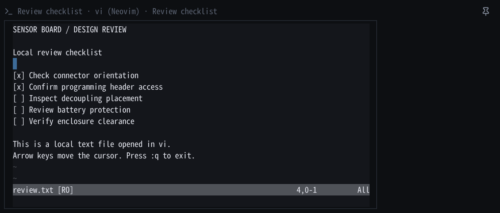
  </p>

- `/btw` para preguntas rápidas al margen.

  <p align="center">
    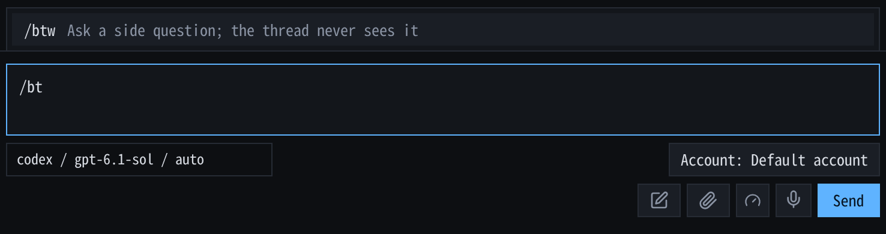
  </p>

- Bóveda de secretos: los agentes usan claves API y tokens por nombre sin ver sus valores.
- Dictado por voz, notificaciones push a tu teléfono y acciones de git, worktrees y PRs dentro del hilo.

## Cómo funciona

Un hub por máquina gestiona el registro de eventos, los procesos de agentes, git y los observadores de archivos. La aplicación de escritorio, el navegador y los clientes de iOS y Android se conectan a ese hub, y tus máquinas pueden vincularse mediante Tailscale. Los agentes editan KiCad a través del servidor IPC del fork. El hub está escrito en Rust y se ejecuta sobre Tokio (y la app de escritorio en GPUI). Las reglas importantes se expresan como leyes en [`LAWS`], con pruebas en [`PROOF`] verificadas por el compilador.

## Documentación

- [Instalación](docs/install.es.md), [ajustes](docs/settings.md), [secretos](docs/secrets.md)
- [KiCad IPC](docs/kicad-ipc.md), [revisión de diseño](docs/design-review.md), [git](docs/git.md)
- [Bots, salas y rutinas](docs/bots.md), [el uberbot](docs/uber.md), [terminales](docs/terminal.md)
- [Pedidos](docs/order.md), [voz](docs/voice.md), [telemetría](docs/telemetry.md)
- [`AGENTS.md`](AGENTS.md): mapa del código

## Contribuir

Se agradecen *issues* y *pull requests*. Compilar requiere Rust, Bun y Python 3.12+. Empieza por [`AGENTS.md`](AGENTS.md) para ver el mapa del código y [pruebas locales](docs/local-testing.md) para compilaciones y vistas previas aisladas. La [guía de escritorio](desktop/README.md) cubre el shell de escritorio, y la [guía móvil](mobile/README.md) cubre las aplicaciones móviles.

## Licencia

MIT. Consulta [LICENSE](LICENSE). El [fork de KiCad](https://github.com/BackplaneWorks/Backplane_KiCad) conserva la licencia de KiCad. El conversor STEP (`native/step2glb`) enlaza Open CASCADE Technology (LGPL-2.1 con la excepción de Open CASCADE); consulta las [licencias de terceros](deploy/licenses/step2glb/NOTICE.md).

<p align="center">
  
</p>
