<p align="right">
  <a href="README.md"></a>
</p>

Backplaneは、エージェントによるハードウェア開発のためのオープンソースのワークスペースです。エージェントがKiCadとFreeCADのファイルを編集し、あなたは基板・回路図・3D・機械設計のビューアで作業を確認し、部品をクリックして話しかけられます。

- **好きなエージェントを選べます。** Claude、Codex、Grok、OpenCode、Muse Code、Antigravity、Pi、Oh My Piを、一つのワークスペースで。
- **エージェント向けのKiCadフォーク。** [Backplane KiCad](https://github.com/BackplaneWorks/Backplane_KiCad)は基板と回路図のIPC APIを追加し、エージェントがKiCad経由で編集できるようにします。
- **設計の履歴。** 基板や回路図の変更をチェックポイントに保存。過去の作業に戻り、版を比較し、レビューコメントを残せます。
- **デスクトップ・Web・スマートフォン。** デスクトップアプリ、ブラウザ、iOS、Androidのクライアントがハブに接続します。
- **MITライセンス。** 電気エンジニアが開発・保守しています。

<p align="center">
  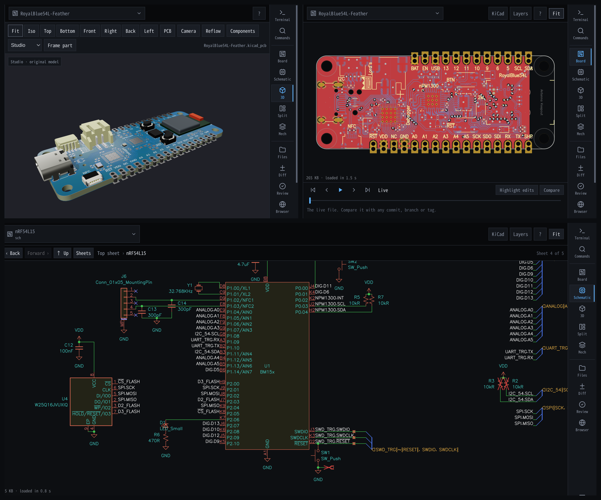
</p>

## インストール

```sh
curl -fsSL https://github.com/BackplaneWorks/Backplane/releases/latest/download/install.sh | sh
backplane
```

### Windows（x64、実験段階）

[最新リリース](https://github.com/BackplaneWorks/Backplane/releases/latest)から `backplane-v<version>-windows-x64.zip` をダウンロードし、書き込み可能なフォルダーに全体を展開して `Backplane.exe` を開きます。`resources/` とほかの展開ファイルは隣に置いたままにしてください。ElectronアプリとBunハブのポータブル版で、WSLは不要です。シェルコマンドにはCygwinのツールが必要です。同梱されているランタイムを保持してください。ツールがない場合は、[Windowsセットアップスクリプト](scripts/setup-windows.ps1)でCygwinをインストールし、起動前にその `bin` ディレクトリを `PATH` に追加します。エージェントCLIのインストールとサインインは別途必要です。[プロバイダー設定スクリプト](scripts/install-windows-providers.ps1)でClaudeとCodexをインストールできます。

FreeCADと[Backplane KiCadランタイム](https://github.com/BackplaneWorks/Backplane_KiCad/releases)は別途インストールしてください。`BACKPLANE_FREECAD` に実際の `bin/FreeCADCmd.exe`（隣にGUI実行ファイルが必要）、`BACKPLANE_KICAD` にランタイムのルートまたは `bin/kicad-cli.exe` を指定し、Backplaneを再起動します。通常のKiCadには、必要なIPC機能の一部がありません。

Windowsでは、サービスの停止・更新を管理する機能は未対応です。ウィンドウを閉じてもハブは動作し続けます。現在、WindowsのCIスモークチェックは失敗を報告してもビルドを止めないため、ZIPの公開だけではWindowsでの十分な動作確認を意味しません。

セットアップ、スマートフォンとのペアリング、アンインストールは[インストールガイド](docs/install.md)をご覧ください。エージェントCLI、基板・回路図の作業にはKiCad、機械設計にはFreeCADが必要です。AntigravityはSettingsからインストールできます。

## クイックスタート

1. Backplaneを起動し、プロジェクトフォルダ（既存のKiCadプロジェクト、または空のフォルダ）を追加します。
2. 入力欄の下で、エージェント・モデル・推論レベルを選びます。
3. 依頼します。たとえば「回路図に3.3VのLDOとデカップリングを追加して」「DRCを確認して修正して」「この基板のケースを設計して」。
4. Board・Schematic・3D・Mechタブで作業を確認します。部品やネットをクリックすると回路図と基板の対応する箇所がハイライトされ、次のメッセージで部品を参照することもできます。

<p align="center">
  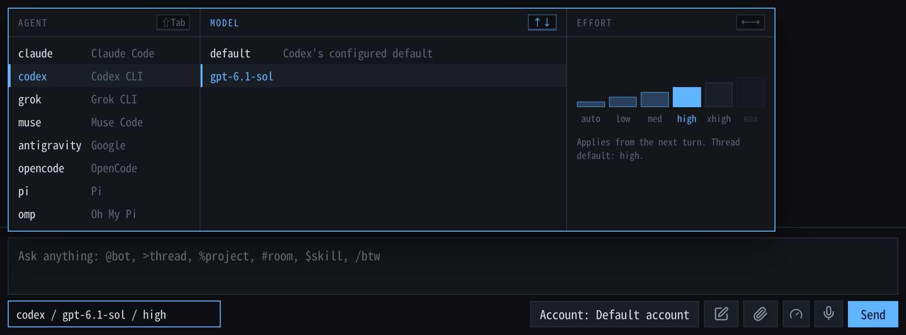
</p>

## CAD

エージェントの作業に合わせて、ビューアで設計を確認できます。

- **Board・Schematic・3D。** 階層回路図、KiCadと同じ順序・名前のレイヤー操作、ビュー間のクロスプロービング。
- **Mech。** STEPやGLBモデルを表示します。エージェントがFreeCADのスクリプトで部品をモデリングし、STEPを出力して、ここに表示します。
- **履歴とレビュー。** 版の比較、シートやレイヤーごとの変更確認、基板や回路図上の位置へのコメント、ReviewタブでのBOM・ERC・DRCチェック。
- **スキル。** [KiStack](https://github.com/BackplaneWorks/kistack)のKiCad用スキルが付属します。回路図、レイアウト、フットプリント、BOM、製造用出力など。
- **発注。** 設計に製造用ファイルがあれば、Buy itで設計を確認して見積もるスレッドが開きます。[発注ガイド](docs/order.md)をご覧ください。

<p align="center">
  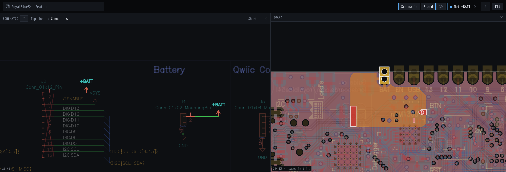
</p>

<p align="center">
  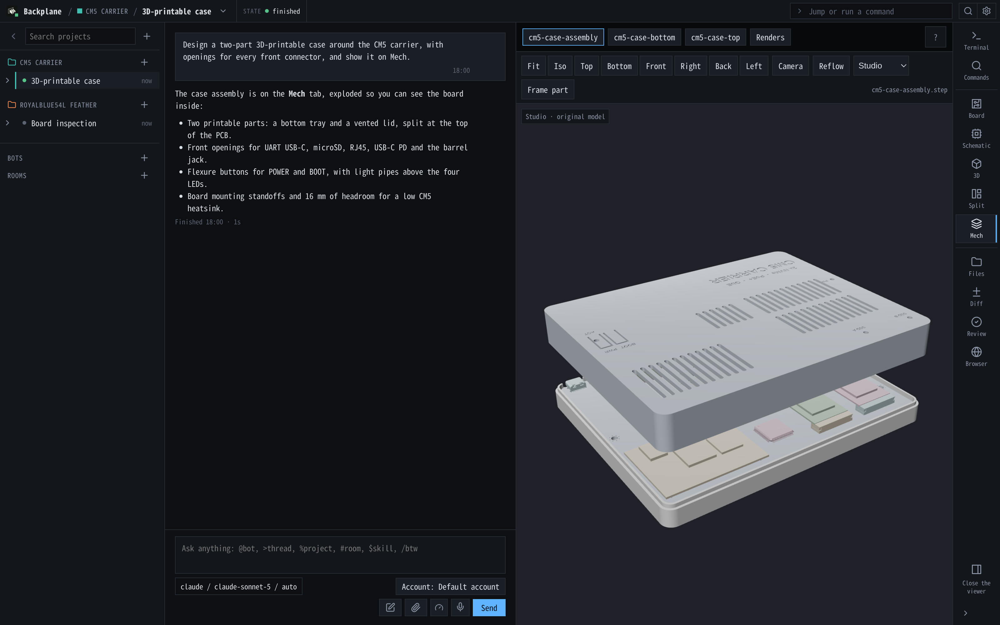
</p>

<p align="center">
  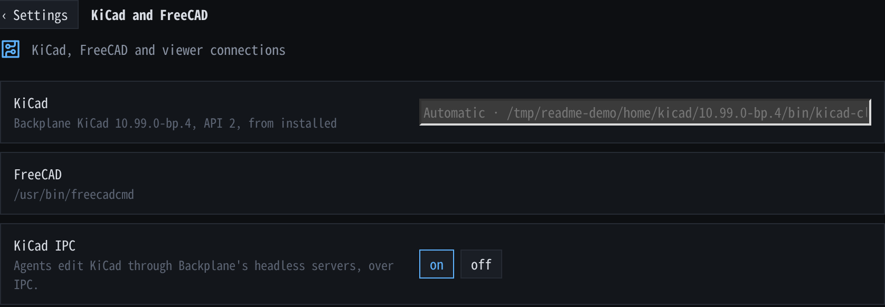
</p>

## オーケストレーション

プロジェクトにはスレッドがあります。エージェントは別のプロバイダーのサブエージェントを起動でき、スレッド同士でメッセージを送れます。「uberbot」をメインのインターフェースにして、ボット・プロジェクト・スレッドをまとめられます。

<p align="center">
  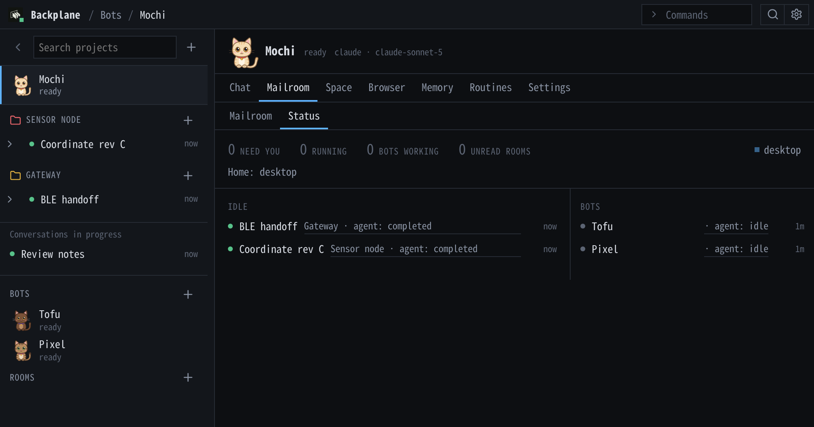
</p>

<p align="center">
  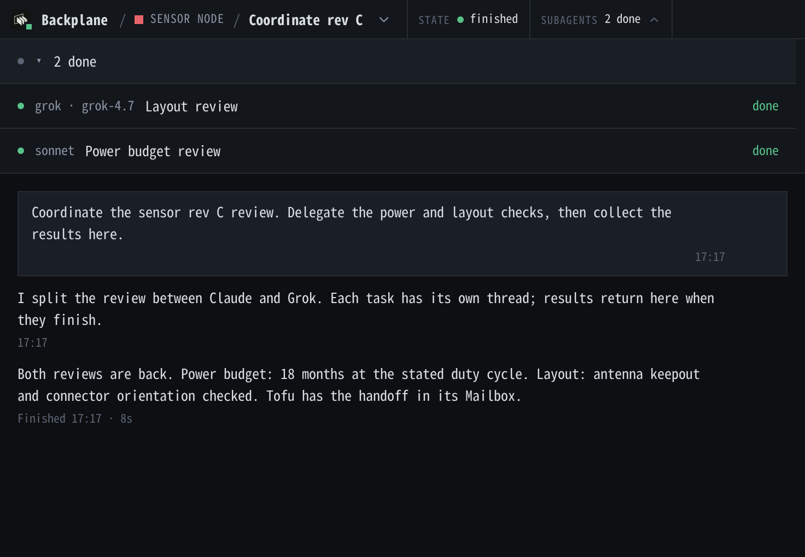
</p>

### Catbots

Catbotsは、特定の仕事を担当する常駐エージェントです。Webhookとルーティン、やり取りのためのメールボックス、そしてボットが永続的なWebアプリを配信する「Space」があります。

<p align="center">
  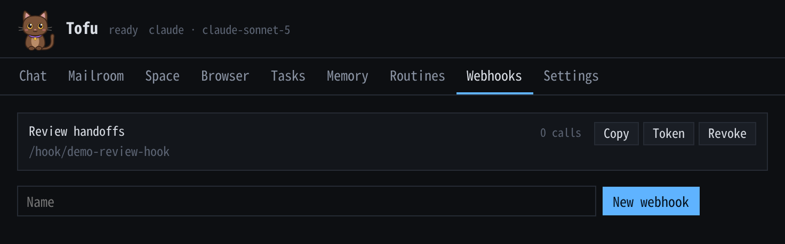
</p>

<p align="center">
  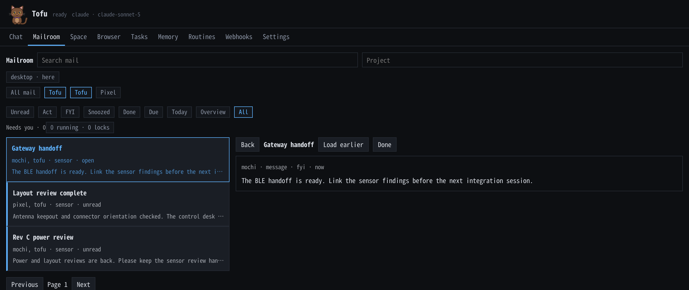
</p>

<p align="center">
  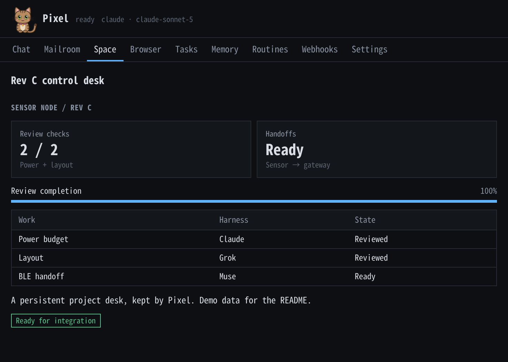
</p>

<p align="center">
  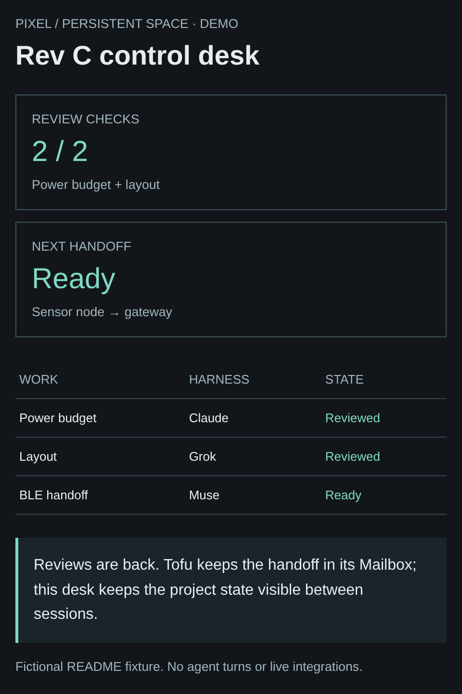
</p>

## その他の機能

- スレッド・ボット・プロジェクトをつなぐ、クリック可能なリンク。

  <p align="center">
    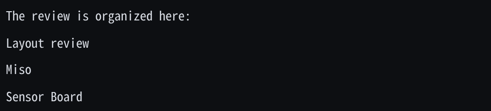
  </p>

- `>`、`#`、`%`、`@`で、ほかのBackplane項目を参照。

  <p align="center">
    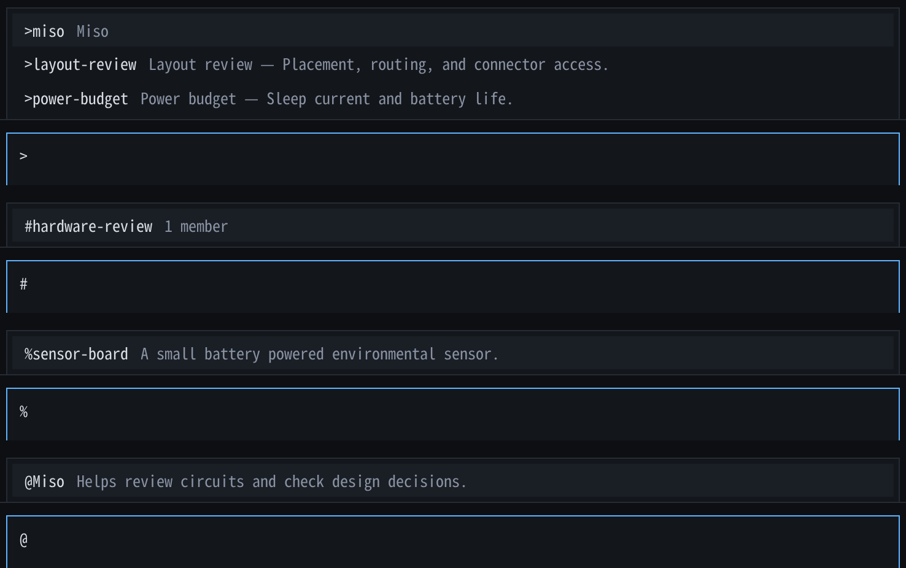
  </p>

- TUI用のインラインターミナル。

  <p align="center">
    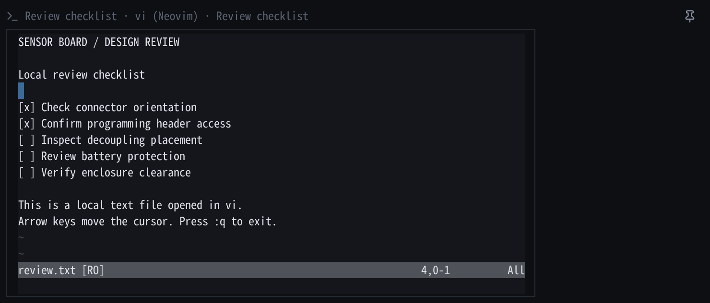
  </p>

- 別の質問をするための`/btw`。

  <p align="center">
    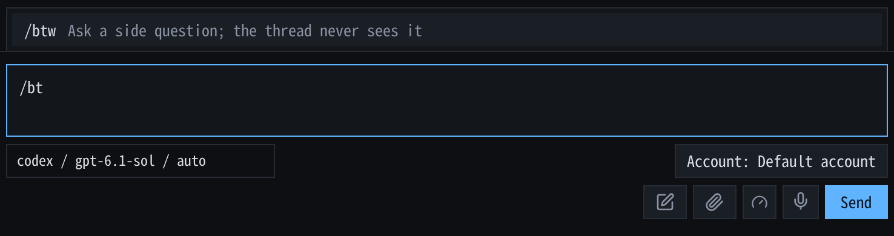
  </p>

- シークレットの保管庫。エージェントはAPIキーやトークンを名前で使い、値は見えません。
- 音声入力、スマートフォンへのプッシュ通知、スレッド内でのgit・worktree・PR操作。

## 仕組み

1台のマシンにつき1つのハブが、イベントログ、エージェントのプロセス、git、ファイル監視を管理します。デスクトップアプリ、ブラウザ、iOS、Androidのクライアントがそのハブに接続し、自分のマシン同士をTailscale経由でペアリングできます。エージェントはフォークのIPCサーバー経由でKiCadを編集します。ハブはで書かれ、Bun上で動きます。重要なルールは[`LAWS`]に法則として記述され、[`PROOF`]の証明をコンパイラが検査します。

## ドキュメント

- [インストール](docs/install.md)、[設定](docs/settings.md)、[シークレット](docs/secrets.md)
- [KiCad IPC](docs/kicad-ipc.md)、[設計レビュー](docs/design-review.md)、[git](docs/git.md)
- [ボット・ルーム・ルーティン](docs/bots.md)、[uberbot](docs/uber.md)、[ターミナル](docs/terminal.md)
- [発注](docs/order.md)、[音声](docs/voice.md)、[テレメトリ](docs/telemetry.md)
- [`AGENTS.md`](AGENTS.md)：コードの地図

## コントリビュート

IssueとPull Requestを歓迎します。ビルドには、Bun、Python 3.12以上が必要です。コードの構成は[`AGENTS.md`](AGENTS.md)、独立した環境でのビルドとプレビューは[ローカルテスト](docs/local-testing.md)をご覧ください。[デスクトップガイド](desktop/README.md)はElectronシェル、[モバイルガイド](mobile/README.md)はスマートフォンアプリを説明しています。

## ライセンス

MIT。[LICENSE](LICENSE)をご覧ください。[KiCadフォーク](https://github.com/BackplaneWorks/Backplane_KiCad)には、KiCadのライセンスが引き続き適用されます。STEPコンバーター（`native/step2glb`）はOpen CASCADE Technology（LGPL-2.1、Open CASCADEの例外付き）をリンクしています。[サードパーティーのライセンス](deploy/licenses/step2glb/NOTICE.md)をご覧ください。

<p align="center">
  
</p>
