<p align="right">
  <a href="README.md"></a>
</p>

1. Backplaneは、エージェントによるハードウェア開発のための、完全にオープンソースのワークスペースです。
2. Backplaneは[KiCadのフォーク](https://github.com/i2cjak/Backplane_KiCad)です。
3. Backplaneは、実際の電気エンジニアが開発・保守しています。

<p align="center">
  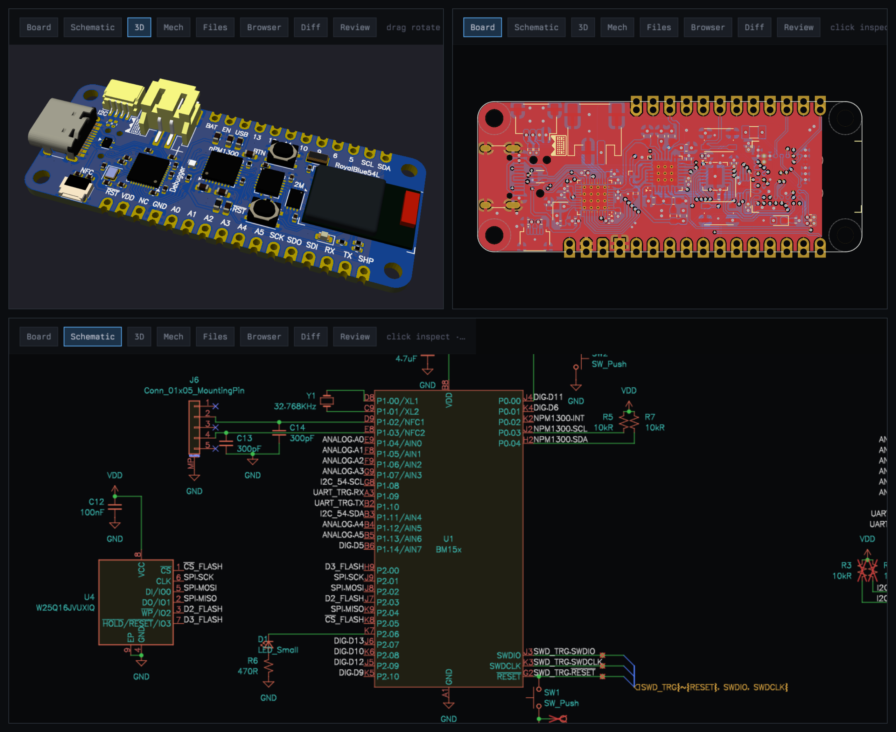
</p>

```sh
curl -fsSL https://github.com/i2cjak/backplane-bend/releases/latest/download/install.sh | sh
backplane
```

<p align="center">
  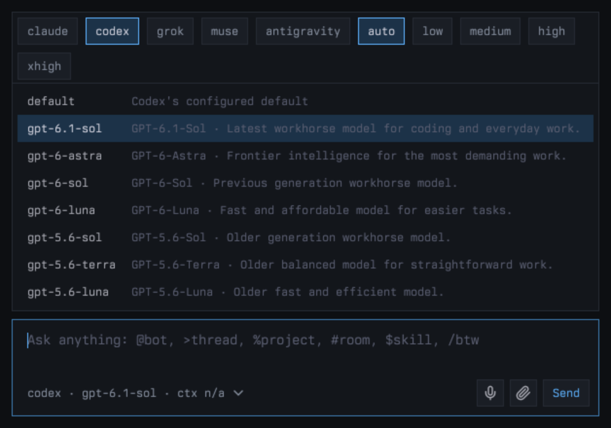
</p>

Backplaneの本当の価値は、KiCadとFreeCADのビューアにあります。エージェントの作業を一つひとつ確認し、特定の部品をクリックして、ワークバーで参照できます。Backplaneには、CAD専用スキル一式と、LLMからの操作を支援する機能を追加したKiCadフォークが付属しています（たとえば、回路図用のIPC API）。

<p align="center">
  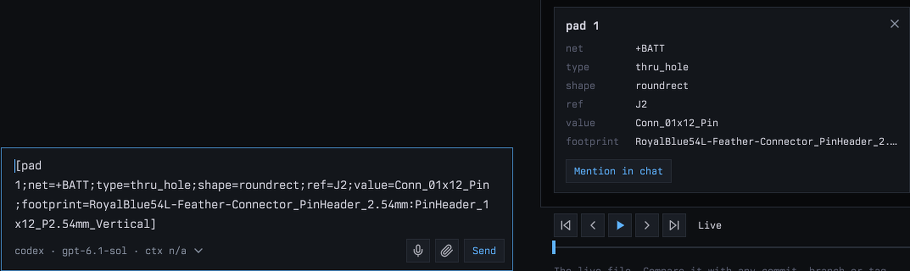
</p>

<p align="center">
  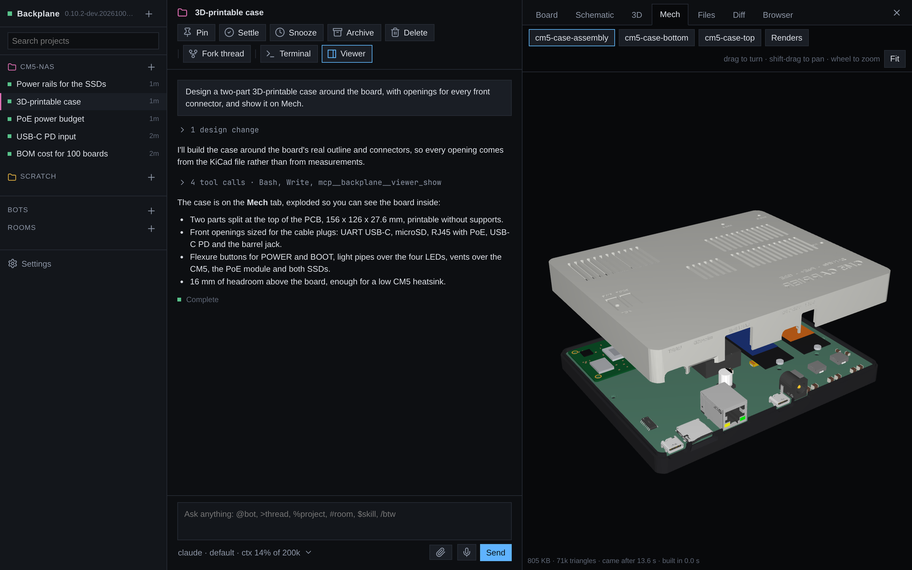
</p>

<p align="center">
  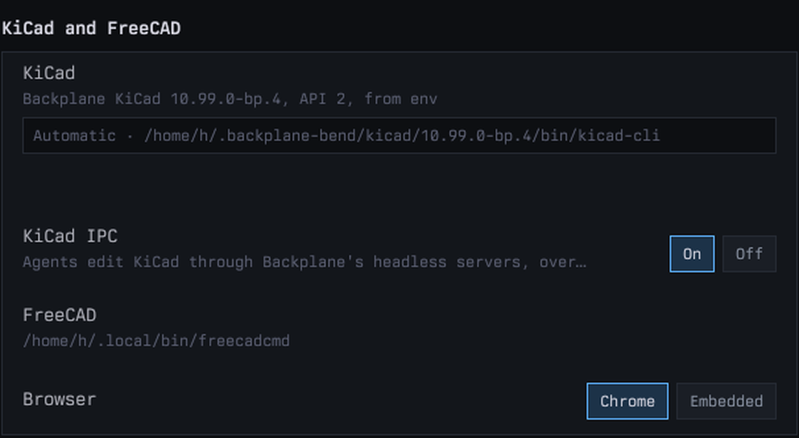
</p>

Backplaneには、エージェントハーネスを連携させるための便利な基本機能があります。プロジェクトにはスレッドがあり（なんて斬新なアイデアでしょう）、ボットと、ボット・プロジェクト・スレッドをまとめる「uberbot」があります。どのハーネスからでも、別のハーネスのサブエージェントを作成でき、すべてのハーネスがスレッド間でメッセージを送れます。

<p align="center">
  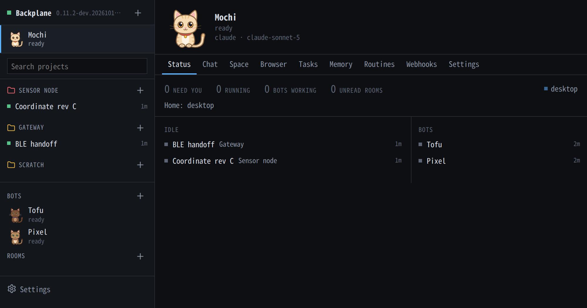
</p>

<p align="center">
  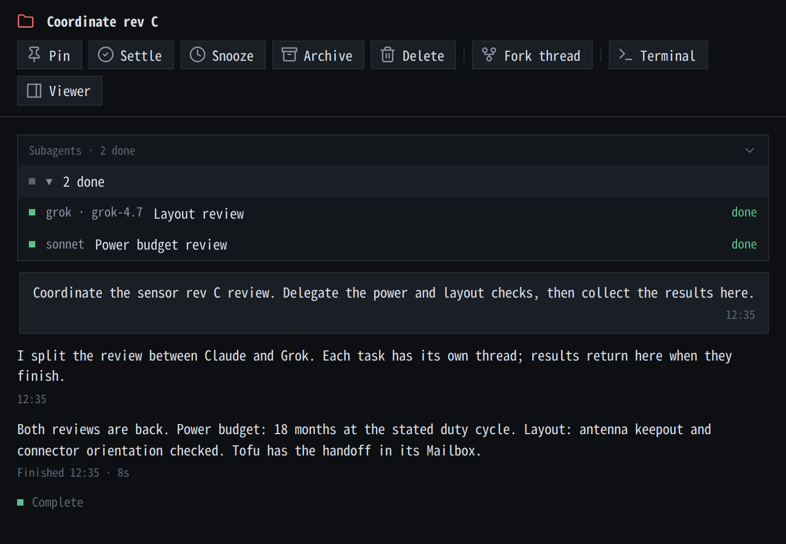
</p>

特定の仕事を担当する常駐エージェント（catbots）も付属しています。Webhookなど、期待する機能はひと通りあります。それに加えて、やり取りのための便利なメールボックスと、ボットが永続的なWebアプリを作成できる「Space」もあります。

<p align="center">
  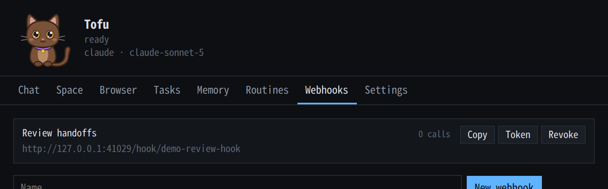
</p>

<p align="center">
  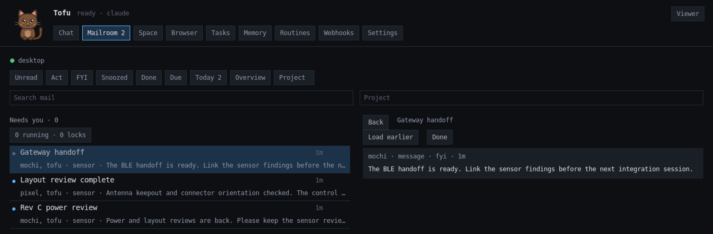
</p>

<p align="center">
  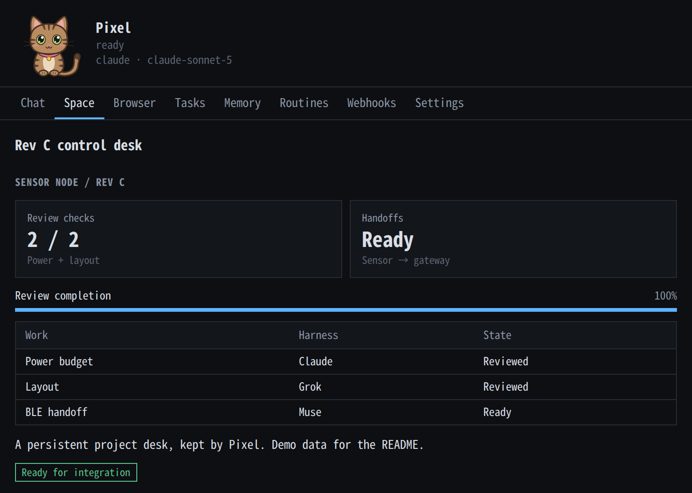
</p>

<p align="center">
  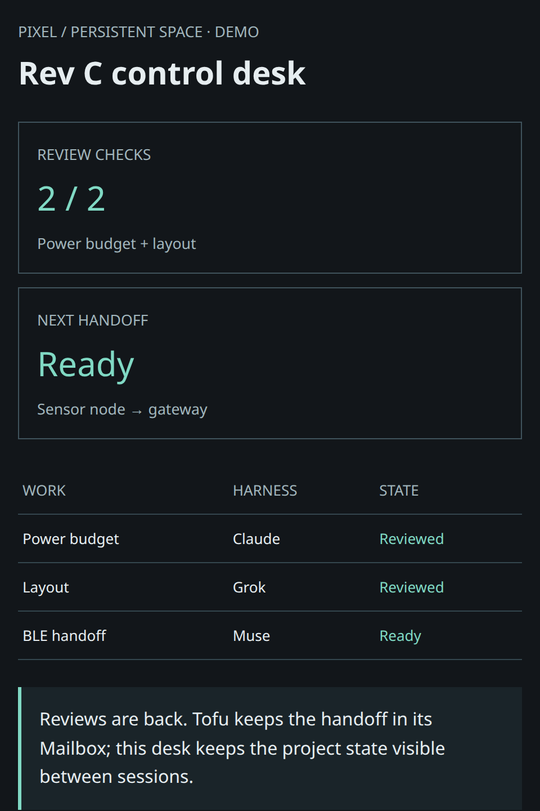
</p>

## その他の機能

- スレッド・ボット・プロジェクトをつなぐ、クリック可能なリンク。

  <p align="center">
    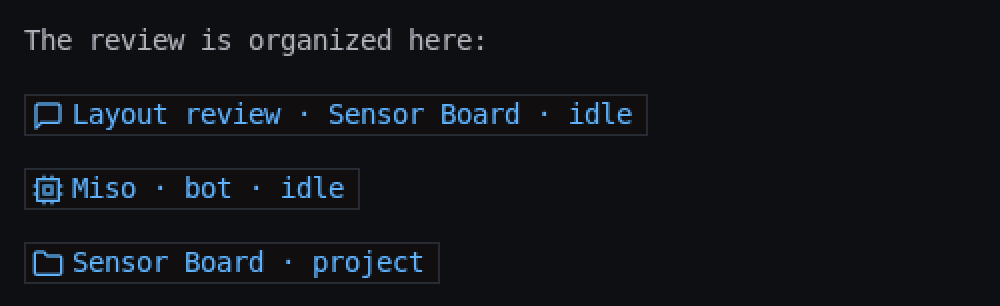
  </p>

- `>`、`#`、`%`、`@`で、ほかのBackplane項目を参照。

  <p align="center">
    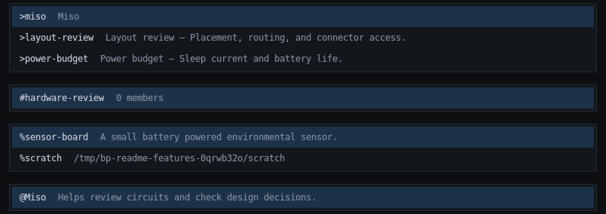
  </p>

- TUI用のインラインターミナル。

  <p align="center">
    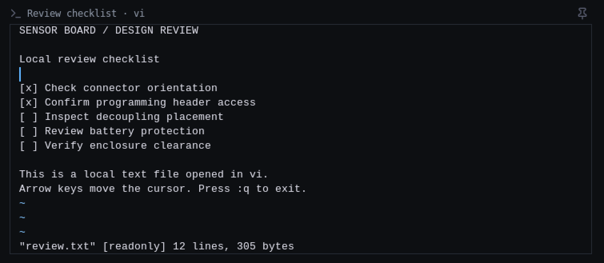
  </p>

- `/btw`。

  <p align="center">
    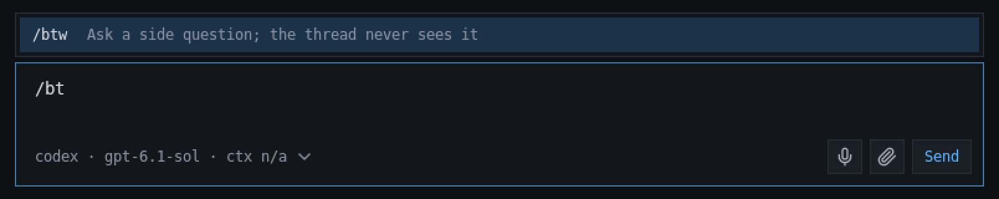
  </p>

Backplaneでは、好きなエージェントを使えます。Grokでも、Codexでも、Claudeでも、Antigravityでも、Museでも、何でもどうぞ。OpenCodeにも対応しています！

## ライセンス

MIT。[LICENSE](LICENSE)をご覧ください。[KiCadフォーク](https://github.com/i2cjak/Backplane_KiCad)には、KiCadのライセンスが引き続き適用されます。STEPコンバーターには、OpenCascadeと`occt-import-js`（LGPL-2.1）が含まれています。[サードパーティーのライセンス](tools/step2glb/README.md#license)をご覧ください。

<p align="center">
  
</p>
