<p align="left">
  <a href="README.jp.md"></a>
</p>

<p align="center">
  
</p>

Backplane is an open-source workspace for agentic hardware development. Your agent edits KiCad and FreeCAD files; you follow the work in board, schematic, 3D and mechanical viewers, click a part, and talk about it.

- **Your agent, your choice.** Claude, Codex, Grok, OpenCode, Muse Code, Antigravity, Pi and Oh My Pi, in one workspace.
- **A KiCad fork built for agents.** [Backplane KiCad](https://github.com/BackplaneWorks/Backplane_KiCad) adds board and schematic IPC APIs so agents can edit through KiCad.
- **Design history.** Changes to boards and schematics are checkpointed. Revisit earlier steps, compare versions, and leave review comments.
- **Desktop, web and phones.** The desktop app, browser, iOS and Android clients connect to the hub.
- **MIT licensed.** Made and maintained by electrical engineers.

<p align="center">
  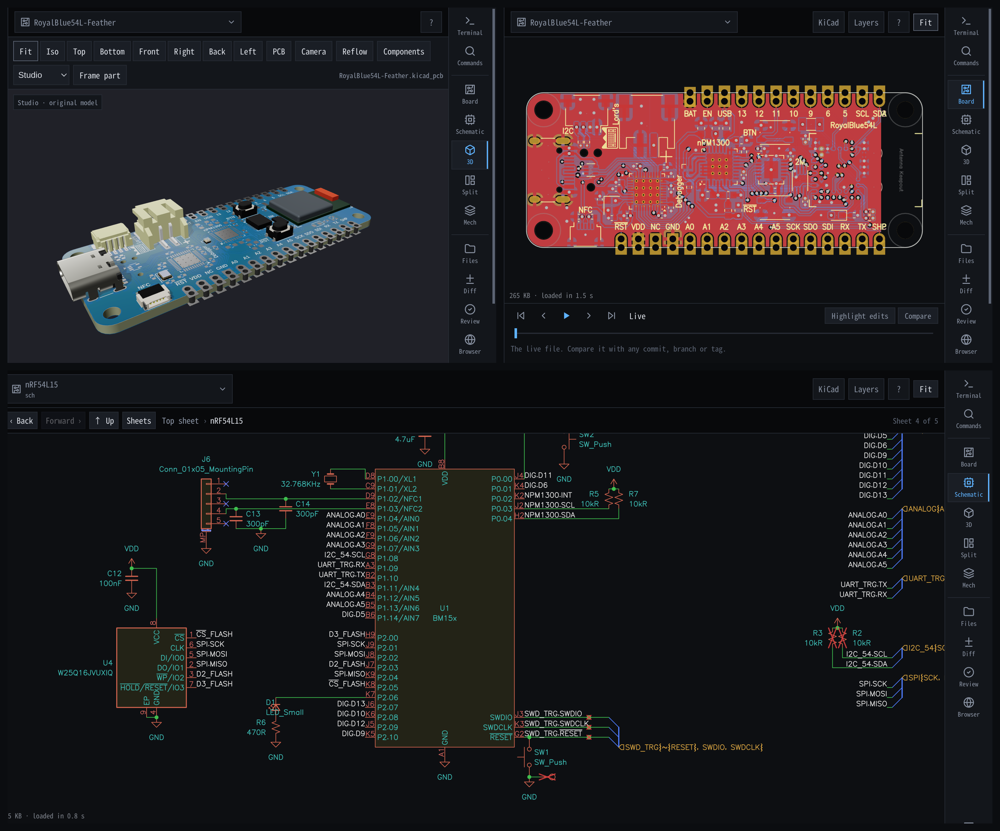
</p>

## Install

**Linux**

```sh
curl -fsSL https://github.com/BackplaneWorks/Backplane/releases/latest/download/install.sh | sh
backplane
```

Linux (x64, arm64): the same one-liner, or `backplane-v<version>-linux-<arch>-native.tar.gz` from the [latest release](https://github.com/BackplaneWorks/Backplane/releases/latest), unpacked as is (the client finds the embedded browser's files beside it).

**macOS (Apple silicon).** Use the same one-liner, or download `backplane-v<version>-darwin-arm64.tar.gz`. Builds are **not notarized yet**: if macOS refuses to open the app, right-click (or Control-click) it in Finder → Open → Open, or on macOS 15+ use System Settings → Privacy & Security → "Open Anyway", or run `xattr -dr com.apple.quarantine /Applications/Backplane.app`.

**Windows (x64, experimental).** Download `backplane-v<version>-windows-x64.zip`, extract the whole archive into a writable folder, and run `Backplane.exe`.

**Phones.** iOS installs through a TestFlight invitation; Android uses the APK on the release. Pair one in Settings → Devices → Add a device with a pairing link, QR code or short code.

The first run asks about anonymous usage counts in a popup; they are on by default and Settings turns them off.

See [installation](docs/install.md) for details, Windows setup, phone pairing and uninstalling. You need an agent CLI, KiCad for board and schematic work, and FreeCAD for mechanical work. Antigravity can be installed from Settings.

## Quick start

1. Start Backplane and add a project folder: an existing KiCad project or an empty folder.
2. Pick an agent, model and reasoning effort under the composer.
3. Ask for something: "add a 3.3 V LDO and decoupling to the schematic", "check the DRC and fix it", or "design a case for this board".
4. Follow the work in the Board, Schematic, 3D and Mech tabs. Click components or nets to highlight them across the schematic and board, or reference a part in your next message.

<p align="center">
  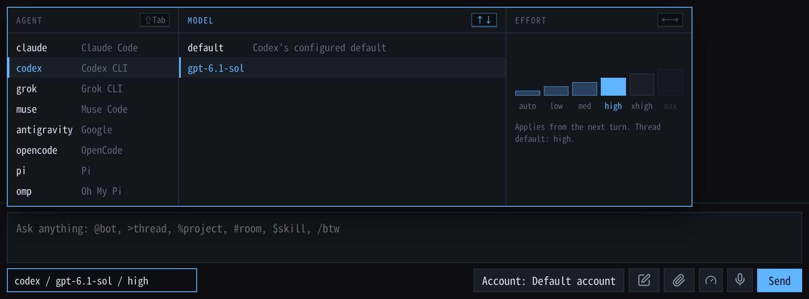
</p>

## CAD

The viewers show the design as the agent works.

- **Board, Schematic, 3D.** Hierarchical schematics, layer controls in KiCad’s order and names, and cross-probing between views.
- **Mech.** View STEP or GLB models. Agents model parts with FreeCAD scripts, export STEP, and show the result here. Mechanical-only folders need no KiCad project; see the [mechanical quickstart](docs/mechanical.md).
- **History and review.** Compare versions, inspect changes by sheet and layer, pin comments to a board or schematic, and run BOM, ERC and DRC checks from the Review tab.
- **Skills.** KiCad skills from [KiStack](https://github.com/BackplaneWorks/kistack) ship with the app: schematic, layout, footprints, BOM and fabrication exports.
- **Ordering.** When a design has a fab file, Buy it opens a thread that checks the design and gets a quote. See [ordering](docs/order.md).

<p align="center">
  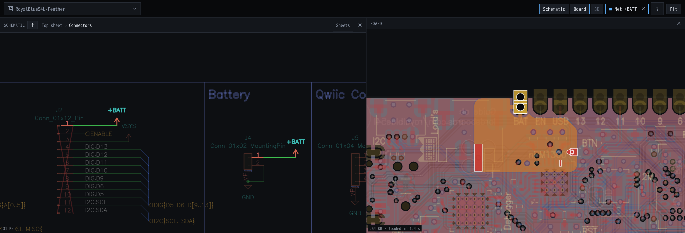
</p>

<p align="center">
  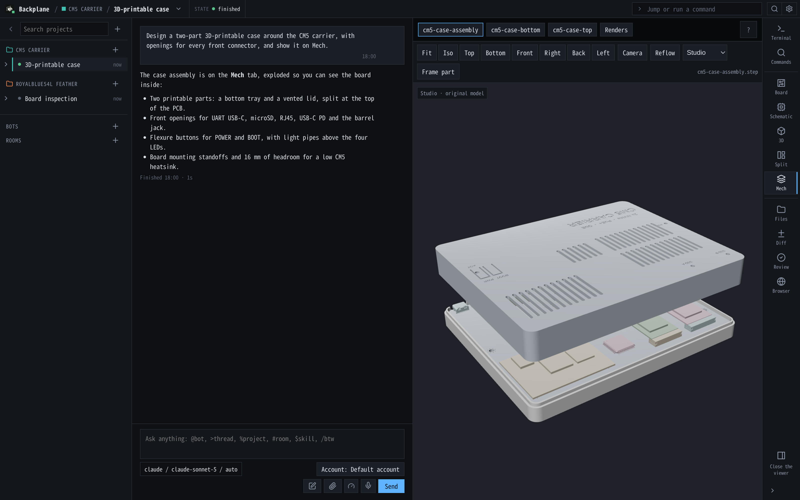
</p>

<p align="center">
  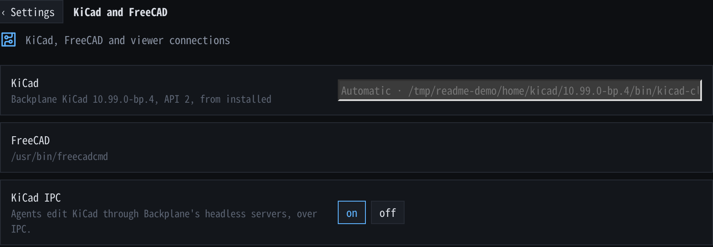
</p>

## Orchestration

Projects contain threads. Agents can start subagents using other providers, and threads can message each other. An "uberbot" can coordinate bots, projects and threads as your main interface.

<p align="center">
  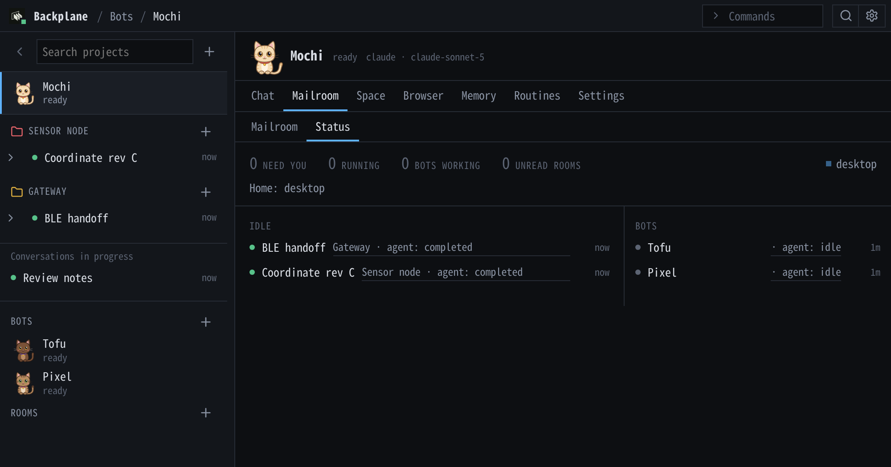
</p>

<p align="center">
  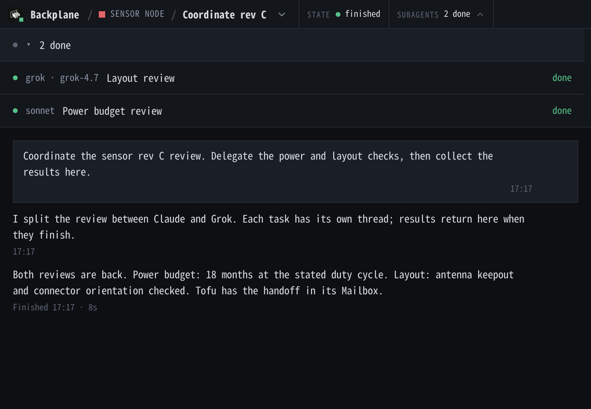
</p>

### Catbots

Catbots are persistent agents for specific jobs. They have webhooks and routines, a mailbox for communication, and a "space" where the bot serves a persistent web app.

<p align="center">
  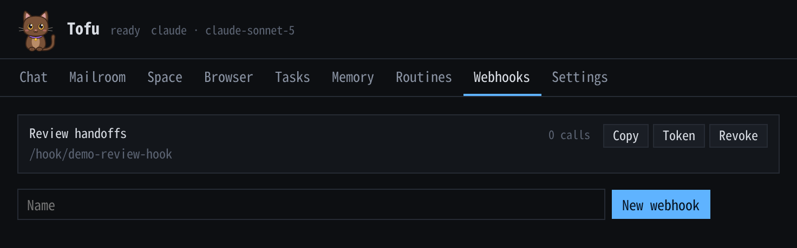
</p>

<p align="center">
  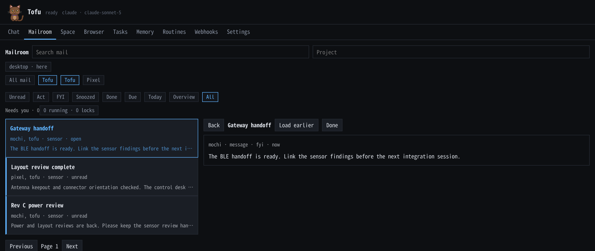
</p>

<p align="center">
  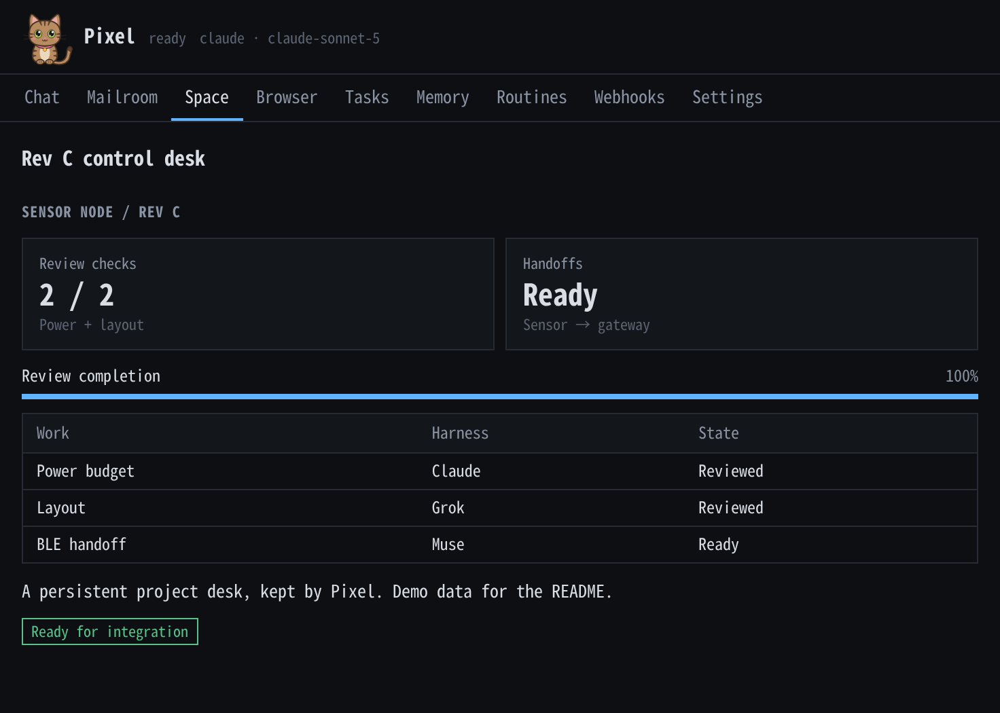
</p>

<p align="center">
  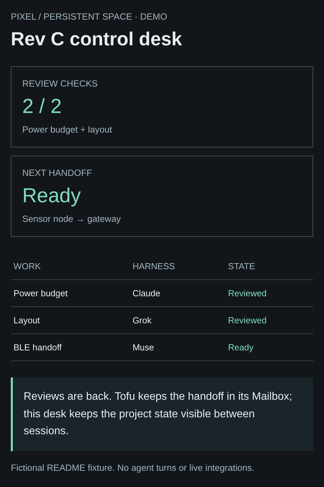
</p>

## Other features

- Clickable links between threads, bots and projects.

  <p align="center">
    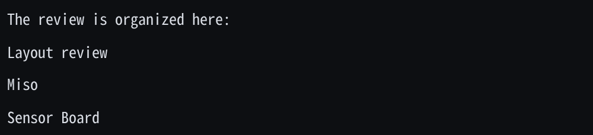
  </p>

- References to other Backplane items with `>`, `#`, `%`, `@`.

  <p align="center">
    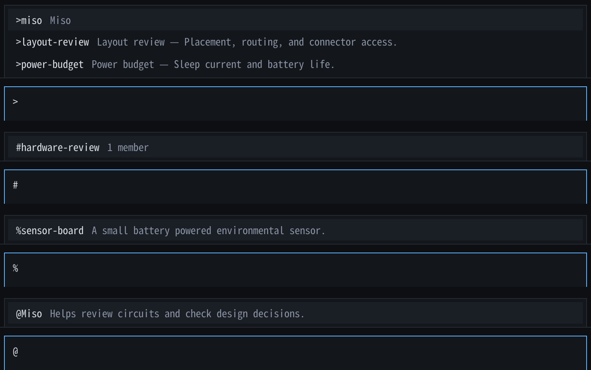
  </p>

- Inline terminals for TUIs.

  <p align="center">
    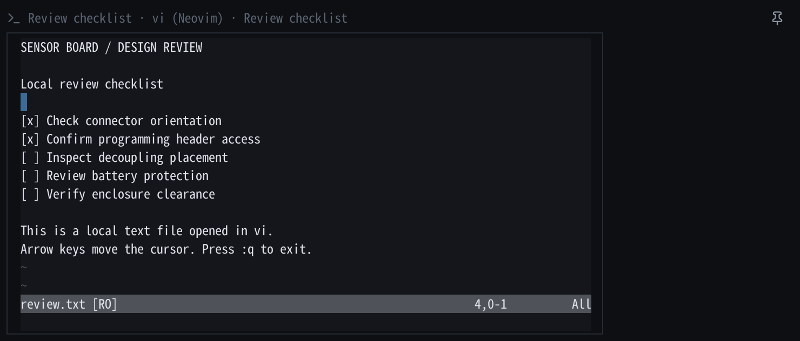
  </p>

- `/btw` for side questions.

  <p align="center">
    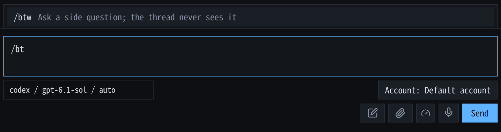
  </p>

- A secret vault: agents use API keys and tokens by name without seeing their values.
- Voice dictation, push alerts to your phone, and git, worktree and PR actions in the thread.

## How it works

One hub per machine owns the event log, agent processes, git and file watchers. The desktop app, browser, iOS and Android clients connect to that hub, and your machines can pair over Tailscale. Agents edit KiCad through the fork’s IPC server. The hub is written in  and runs on Bun. Important rules are stated as laws in [`LAWS`], with proofs in [`PROOF`] checked by the compiler.

## Docs

- [Install](docs/install.md), [settings](docs/settings.md), [secrets](docs/secrets.md)
- [KiCad IPC](docs/kicad-ipc.md), [design review](docs/design-review.md), [git](docs/git.md)
- [Bots, rooms and routines](docs/bots.md), [the uberbot](docs/uber.md), [terminals](docs/terminal.md)
- [Ordering](docs/order.md), [voice](docs/voice.md), [telemetry](docs/telemetry.md)
- [`AGENTS.md`](AGENTS.md): the code map

## Contributing

Issues and pull requests are welcome. Building needs , Bun and Python 3.12+. Start with [`AGENTS.md`](AGENTS.md) for the code map and [local testing](docs/local-testing.md) for isolated builds and previews. The [desktop guide](desktop/README.md) covers the Electron shell, and the [mobile guide](mobile/README.md) covers the phone apps.

## License

MIT. See [LICENSE](LICENSE). The [KiCad fork](https://github.com/BackplaneWorks/Backplane_KiCad) retains KiCad's licensing. The STEP converter (`native/step2glb`) links Open CASCADE Technology (LGPL-2.1 with Open CASCADE's exception); see [third-party licensing](deploy/licenses/step2glb/NOTICE.md).

<p align="center">
  
</p>
