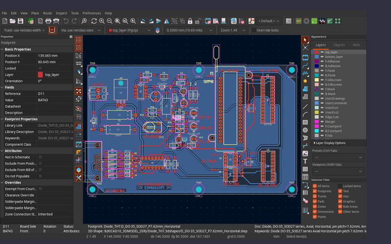
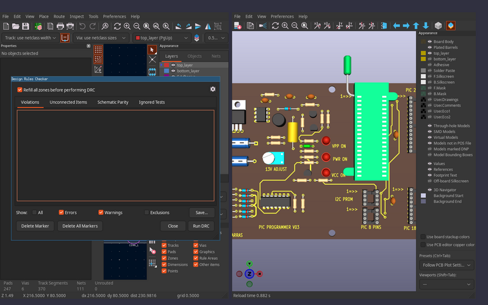

# Embedded editors: KiCad and FreeCAD inside a Backplane pane

The real KiCad editors (our fork, Backplane KiCad 10.99-bp) and FreeCAD run as their own processes, and their windows are children of the Backplane window, drawn in a pane.
This is not frame copying. It follows the Browser's move to a native CEF child window.
The GPUI viewers (Board, Schematic, 3D, Mech) stay for quick looks, for remote hubs and for phones. **Edit** switches a pane from a viewer to the editor.

Status: built for Linux (X11 and XWayland), KiCad 10.0 and Backplane KiCad 10.99.0-bp.8; tested by test/kicad_embed (docs/kicad-embed-e2e.md). Windows and macOS are not yet built (see the platform table); FreeCAD is not yet built.

## What the person sees

- The viewer bar gets **Edit** beside Open in KiCad. On Board, Schematic or 3D it opens the project's KiCad in the pane, showing that editor. On Mech it opens FreeCAD on the part.
- While a pane is editing, its rail items (Board, Schematic, 3D) switch frames inside the same KiCad. A small strip at the pane's top lists the open frames: PCB, Schematic, and Symbol editor, Footprint editor and 3D once they are open. It also has **View** (back to the GPUI viewer), **Full screen** and the key-owner mark.
- A 2 px accent ring on the pane means the editor has the keyboard. With no ring, Backplane has it.
- Closing the pane, the thread or the project while something is unsaved asks once, in Backplane: Save all, Discard, or Cancel.

## Processes and ownership

- **The hub spawns the editors** (through `proc.rs`, like every process). This gives one place for lifecycle, crash restart, unsaved-change checks and IPC routing. The client gives the hub its parent window id.
- **One KiCad process per project copy.** A worktree thread's copy is a different project, so it gets its own process. Each process holds all the frames for its project, through KIWAY:
  - the PCB editor and the schematic editor;
  - the symbol and footprint editors;
  - the 3D viewer;
  - the project manager (`KICAD_MANAGER_FRAME`). It hosts the KIWAY but is never shown: Backplane's Files pane does its job.
- Because all frames share one KIWAY, cross-probing (select in the schematic and see it in the PCB), net highlighting, Update PCB from Schematic and opening a symbol in its editor all work as they do in KiCad.
- **IPC routing.** While a project's GUI KiCad is up, the hub sends that project's IPC (agents' `kicad_ipc`) to the GUI process, not to the headless `kicad-cli api-server`. The headless server for that project gets `kiapi.backplane.Shutdown`, so the two never hold the same files. When the GUI goes away, the headless server comes back on the next request. This is what makes agents' edits show live:
  - an agent's commit lands in the open document, on KiCad's undo stack, so the person can Ctrl+Z it;
  - the requests `kserve::headless_refused` blocks today (selection, view, `RunAction`) work while the GUI is up.
- **Only on the hub's own machine.** A window viewing a remote hub has no local process to embed, so it keeps the viewers and Open in KiCad. Phones keep the viewers. The hub publishes the editor state (below) so every client can at least show "being edited in KiCad on <machine>".
- **State comes from the hub**, as the UI rule requires. Per project copy, an info key `editor.kicad.<project>` holds:
  - the process state: starting, ready, failed or stopped, with the reason;
  - the open frames: kind, document, title, modified, window id.

  The client draws the strip and the rings from it. A pure function in the hub decides which frame a rail item maps to, and it has a test.

## Embedding per platform

| | KiCad (wxGTK / wxMSW) | FreeCAD (Qt) | Verdict |
|---|---|---|---|
| Linux X11 | fork: frames created as children of `--parent-window <xid>` | addon: main window `setParent(QWindow::fromWinId(xid))` | **embed** |
| Linux Wayland desktop | the GPUI client is X11-only and already runs through XWayland, so KiCad (`GDK_BACKEND=x11`) and FreeCAD (`QT_QPA_PLATFORM=xcb`) take the X11 path inside XWayland | same | **embed through XWayland**; separate windows if XWayland is missing or the person picks them |
| Windows | fork: frames created `WS_CHILD` of the parent HWND | addon: the same Qt call (Qt sets the parent HWND) | **embed** |
| macOS | an NSView cannot be parented across processes | same | **separate window for now** |

### X11 (the fork)
- New flags on the GUI `kicad`:
  - `--parent-window <xid>`;
  - `--api-socket <path>`: the hub picks the path, as `kserve` does for the headless server;
  - `--parent-pid <hub>`;
  - `--embedded`: chrome and dialog rules, below.
- In embedded mode, `KIWAY_PLAYER` frames are made *unmapped*, and their GDK window is parented under the parent XID before they are ever mapped. The window manager never sees them as top-levels: there is no flash, no taskbar entry and no stolen window. This is done in `EDA_BASE_FRAME` at creation, not by reparenting a visible window. The prototype tries GTK3's `GtkPlug` as the alternative, because it gives XEmbed focus messages for free. We keep whichever makes the GL canvas (GAL on EGL) and input work.
- Each frame is its own child window, all siblings under the same parent:
  - switching a frame maps one and unmaps the others, which is instant because nothing is rebuilt;
  - Split can show the PCB and the schematic side by side as two rectangles of the same process.
- **IPC `AttachToParent {window}`** re-parents every frame under a new XID, unmapped first. A client restart (the dev and main builds swap the window often) gives a new XID. KiCad must survive that, so on detach the frames are unmapped, never left floating as top-levels.

### Windows
The same flags, with an HWND. Frames get `WS_CHILD` and lose `WS_CAPTION`/`WS_THICKFRAME`. A cross-process child window attaches the two threads' input queues, so a hung KiCad can stall Backplane's input. We accept that risk and watch for it: the hub pings the GUI process, and a hang detaches it (`SetParent(NULL)` from Backplane's side) and shows "KiCad is not responding".

### macOS: separate window for now
There is no cross-process NSView parenting. The other route is an IOSurface render plus input forwarding: the fork would draw each frame into a shared IOSurface, and Backplane would forward every mouse, key, IME, drag and cursor event back. That is a second toolkit port of wx and Qt input, and it is not worth starting before the Linux and Windows embed has been used for real. So on macOS:
- **Edit** opens the project's KiCad as its own window. It is the same process and IPC as elsewhere: frame switching, live agent edits, unsaved-change checks and the palette all work.
- The frame is raised over Backplane, sized to Backplane's window on first open and remembered after.
- IOSurface stays an open question, to revisit after the Linux and Windows embed ships.

### FreeCAD
- **An addon, not a fork:** a `BackplaneEmbed` module installed into the FreeCAD user `Mod` directory, or given with `--module-path`, and enabled only when `BACKPLANE_PARENT_WINID` is set.
- On startup it:
  - parents `Gui.getMainWindow()` under the foreign window (`windowHandle().setParent(QWindow.fromWinId(id))`), so Qt supports both xcb and Windows;
  - opens a `QLocalServer` at a path the hub gives, speaking JSON lines with the same verbs as the KiCad embed commands below.
- **Two modes:**
  - **3D view**: the MDI area with the active view maximised, dock widgets, menubar and toolbars hidden;
  - **Workbench**: FreeCAD's whole window, for real modelling.
- One FreeCAD process per project, not per part. The Mech rail's parts become documents in it.
- **Agents keep their headless scripts.** When an agent re-runs `mech/<part>.py`, the addon reloads the changed `.FCStd` if the person has no unsaved changes in it, and shows a reload banner if they do.

## New fork IPC (`kiapi.backplane.embed`)

| Command | Does |
|---|---|
| `AttachToParent {window, scale}` | parent (or re-parent) every frame under the window; `window` 0 detaches (all frames unmapped) |
| `ShowFrame {kind, document?, item?}` | opens or raises a frame (`PCB`, `SCH`, `SYMBOL_EDITOR`, `FOOTPRINT_EDITOR`, `PCB_3D`), and optionally focuses an item; answers its window id |
| `GetFrames` | every open frame: kind, document, title, modified, window id, minimum size |
| `NextEvents {since, wait_ms}` | long poll for events: frame opened or closed, title, modified, focus, and KiCad asking to show a frame itself (for example Edit Symbol). The hub keeps one in flight per process. |
| `SetChrome {menubar, top_toolbar, side_toolbars, status_bar}` | shows or hides KiCad's chrome |
| `ListActions {frame}` | the frame's `TOOL_ACTION`s: name, label, hotkey, enabled, checked. They feed Backplane's palette; `RunAction` already runs one. |
| `SetReservedKeys {chords}` | the chords KiCad forwards to Backplane and does not handle (see Shortcuts) |
| `Close {mode: save, discard or fail_if_modified}` | closes everything without KiCad's own "save changes?" dialog |

`GetOpenDocuments`, `GetDocumentModifiedState`, `SaveDocument`, `RevertDocument`, `RunAction` and the cross-probe messages already exist, and the design uses them as they are.

## Shortcuts

### The model
1. **The editor that has focus gets every key**, except a small reserved set. KiCad gets M, R, X, V, E, Del, Tab, `` ` ``, Esc, Ctrl+Z/Y, Ctrl+C/V/X/D, Ctrl+L, Ctrl+H and Alt+1…4. FreeCAD gets V,1 and the rest of its own keys.
2. **The reserved set always goes to Backplane.** It is configurable in Settings → Keys, under the heading "Kept by Backplane inside editors". These are the defaults:

   | Chord | Backplane action | Free in KiCad? | Free in FreeCAD? |
   |---|---|---|---|
   | Ctrl+K (Cmd+K) | palette (it also lists the editor's own actions) | yes | yes |
   | Ctrl+Tab / Ctrl+Shift+Tab | next / previous pane or frame | yes | yes (FreeCAD uses Ctrl+Tab between MDI views; the addon gives it up, and Backplane's strip switches documents) |
   | Ctrl+J | floating terminal | yes | yes |
   | **Ctrl+`** | **escape chord**: the keyboard goes back to Backplane (the message box) | yes (bare `` ` `` and Alt+`` ` `` are KiCad's; Ctrl+`` ` `` is not) | yes |

   A click on any Backplane surface also takes the keyboard back. Clicking into the editor gives it the keyboard.
3. **How a reserved chord gets out:**
   - The fork installs a filter in `PGM_BASE`'s app (`wxApp::FilterEvent`, the same hook `single_top.cpp` uses). A reserved chord never reaches KiCad's tool dispatcher. KiCad sends it straight to the parent window: a `ClientMessage` (`_BACKPLANE_KEY`) to the parent XID on X11, `PostMessage(WM_APP+…)` to the parent HWND on Windows. There is no hub hop, so it is as fast as a local key.
   - On X11, Backplane also takes passive `XGrabKey`s on its own top-level for the reserved chords. These still work when KiCad is hung.
   - In FreeCAD, the addon puts the same filter on `QApplication`'s `ShortcutOverride` and `KeyPress`.
   - Dialogs (KiCad's and FreeCAD's) keep every key: a reserved chord inside a dialog's text field types or acts as it would there.
4. **The focus ring:** a pane ring in the theme's accent while the editor owns the keys. The strip's mark reads `Keys: KiCad` or `Keys: Backplane`. The change comes from X11 `FocusIn`/`FocusOut` on the child, `WM_SETFOCUS` on Windows, and the `focus` events.

### Conflicts: KiCad's defaults against Backplane's shortcuts
Backplane's bare keys (the rail's B S 3 V M F D R W, `/`) only bind where no viewer or field has the keyboard (`keys.rs` `FREE`). An editor with focus counts as such a place, so bare keys never conflict. These chords do:

| Chord | KiCad default (fork) | Backplane default | Resolution |
|---|---|---|---|
| Ctrl+L | library tree search, length-tuner settings, place global label | focus the message box from anywhere | **KiCad**; Ctrl+`` ` `` does Backplane's job inside editors |
| Ctrl+H | show hierarchy (Eeschema) | layer focus (viewer) | **KiCad**; the viewer isn't on screen |
| Ctrl+D | duplicate | Diff | **KiCad**; Diff from the rail or palette |
| Ctrl+P | print | Files | **KiCad** |
| Ctrl+B | unfill all zones (Pcbnew) | fold the sidebar | **KiCad** |
| Ctrl+N | new (board, symbol, footprint) | new thread | **KiCad** |
| Ctrl+M | move individually (Pcbnew) | model menu | **KiCad** |
| Ctrl+Shift+A | unselect all, draw arc | account menu | **KiCad** |
| Ctrl+Shift+S | Save As | settle thread | **KiCad** |
| Ctrl+Shift+F | import graphics | search threads | **KiCad** |
| Ctrl+Shift+P | graphic polygon (Pcbnew) | palette (also) | **KiCad**; Ctrl+K is the palette |
| Alt+1…4 | fast grid 1/2, 3D viewer (Alt+3), … | project 1…9 | **KiCad** |
| Ctrl+1…9 | Ctrl+4: select connection (Eeschema) | thread 1…9 | **KiCad** for Ctrl+4. The others are free, but not reserved by default (open question). |
| Ctrl+C / V / X / Z / A | copy, paste, cut, undo, select all | the same, for Backplane's text | **KiCad**: the focus decides |
| Esc | cancel tool / clear selection | close popup, dialog or viewer | **KiCad**; it never closes the pane (`ESC_OWNERS` gains the editor scope) |
| `` ` `` | highlight net, restart move | floating terminal (bare) | **KiCad**; Ctrl+J is the terminal |
| Shift+Esc | none | leave the terminal | no conflict |
| Ctrl+K, Ctrl+J, Ctrl+Tab, Ctrl+`` ` `` | none | palette, terminal, panes, escape | **Backplane** (reserved) |
| Ctrl+Shift+[ / ], Ctrl+Shift+U, Ctrl+. | none | prev or next thread, uberbot, stop turn | not reserved by default; they can be added in Settings without clashing |

`keys.rs` gains an `EditorPane` scope, so that every non-reserved binding is left out while it is focused. A test checks the defaults table against a dump of the fork's `DefaultHotkey`s (`ListActions` on a test project), so a new KiCad default that hits a reserved chord fails CI.

## Editors and switching
- **Rail items to frames:** Board maps to `PCB`, Schematic to `SCH` and 3D to `PCB_3D`. Mech maps to FreeCAD. The Symbol and Footprint editor frames appear in the strip when KiCad opens them (Edit Symbol, Edit Footprint, or the agent's `OpenLibraryItem`). Each frame has a close button, and Ctrl+Tab cycles them.
- **Switching** is the client mapping one frame's window and unmapping the others. It knows their ids from the hub's state. Nothing is closed, so a frame keeps its zoom, tool and selection. The hub sends `ShowFrame` only for a frame that isn't open yet.
- **Split** with an editor: the left and right rectangles each show a frame, or one editor and one GPUI viewer.
- **Cross-probing** between KiCad's own frames happens inside KiCad (KIWAY). Between KiCad and Backplane it goes through the hub (`kicad/xprobe.rs`, client `screens/xprobe.rs`):
  - **Chat → KiCad.** A reference (U3), pin (U3.4) or net (GND, /SDA) of the thread's design in a message is a link; the hub lists the names (`kicad.names {thread}`: the board's footprints and nets, every sheet's symbols and labels). A click sends `editor.kicad.select {thread, references, nets, pins, zoom}`: it is selected and zoomed in the open KiCad. With no editor in the pane, the Board page opens and zooms on it instead.
  - **Agents** do the same with the MCP tool `kicad_select {path, references, nets, pins, zoom, show}`; `show` (PCB or SCH) switches the pane first. The answer says what KiCad found.
  - **Backplane's viewers.** The select also sets the hub's board probe (`probe:<root>|<board>`), which every Board, Schematic and Split page lights. A piece tapped in a viewer is selected in KiCad (`from: "viewer"`).
  - **KiCad → Backplane** (bp.9): the person's selection arrives as `ET_SELECTION_CHANGED` (`NextEvents`). The hub publishes it as info `kicad.sel.<digest>` `{project, frame, selection, probe}` and sets the board probe, so the viewers light it.
  - **Runtimes.** bp.9 uses `kiapi.backplane.embed.SelectItems {kind, references, nets, pins, zoom}` on each open PCB/SCH frame (gated on the runtime's `api.desc`). bp.8 has `ShowFrame {kind, item}`: one part is cross-probed (selected and centred) on the shown frame; nets are only lit in Backplane's viewers.
- **The project manager** is hidden in embedded mode. Opening a different project goes through Backplane (another thread or project), not KiCad's File → Open Project. The fork disables that menu item in embedded mode.

## Size and layout
- **Geometry is the client's job**, with no hub in the path. On every layout where the pane moves or changes size, the client moves and resizes the visible frame's child to the pane's rectangle in device pixels (`XMoveResizeWindow` / `SetWindowPos`). An X client may configure any window in its own tree. KiCad sees an ordinary `ConfigureNotify`/`WM_SIZE`. Several layouts in one frame send only the last size.
- **DPI:**
  - X11: the hub starts KiCad with the client's scale (`GDK_SCALE`, `GDK_DPI_SCALE`) and FreeCAD with `QT_SCALE_FACTOR`. A change of scale sends `AttachToParent {scale}`, and KiCad reloads its toolbar icons at the new size, as it does when its own scale setting changes.
  - Windows: both processes run per-monitor-v2 and follow `WM_DPICHANGED_AFTERPARENT`.
- **Minimum size:** `GetFrames` reports each frame's minimum size. A pane smaller than that unmaps the frame and shows the line "Too small for the editor", with **Full screen** and **View** buttons. It never shows a clipped KiCad.
- **Overlays:** a native child covers every GPUI overlay drawn over it, such as menus, the palette, popups, the tour and the Settings dialog. While an overlay intersects the pane, the client cuts that overlay's rectangles out of the child with the X SHAPE extension (`XShapeCombineRectangles`), or `SetWindowRgn` on Windows, so the overlay shows through the hole and the rest of KiCad stays live. If SHAPE is missing, the child is unmapped under an overlay and the pane shows its last frame (one `XGetImage`), as the older native Browser did. This is the same mechanism the CEF child window needs, so it should be **one shared `viewers/native_child.rs`** for both.
- **Chrome:** in embedded mode the menubar is hidden by default. Its actions are in Backplane's palette through `ListActions`, under the frame's name, with KiCad's own hotkeys shown. The toolbars and the layer manager stay. Settings → Editors has a toggle for each (`SetChrome`).
- **Dialogs and modals** stay floating top-levels:
  - X11: the fork sets each dialog's `WM_TRANSIENT_FOR` to Backplane's top-level window (the root of the parent chain, not the child frame, which is not a top-level). It centres the dialog on Backplane's window, so the window manager keeps it above Backplane and moves it with it.
  - Windows: the dialog's owner is Backplane's top-level HWND.
  - The same applies to FreeCAD's task dialogs when they are not docked.
  - Popup menus and tooltips are override-redirect windows placed in screen coordinates. wx computes those through the foreign parent, and the prototype checks this.
- **Full screen** (strip button or palette): the pane takes the whole Backplane window. The sidebar and timeline fold, and the window can go full screen too. Esc does not leave full screen because Esc is KiCad's: the button or Ctrl+`` ` `` does.

## Lifecycle
- **Start** on the first Edit of a project copy. The pane shows a progress line until the first frame exists. **Keep warm:**
  - a process stays up while any pane, thread or tab uses it, plus `editor.idle` (default 30 min) after that;
  - at most `editor.max` GUI processes (default 3) stay warm;
  - the least recently used *clean* process is closed first, and a process with unsaved changes is never closed for room.
- **Crash:** each editor is its own process, so Backplane survives. The hub sees the exit, and the pane says "KiCad stopped" with **Restart**. A restart reopens the same frames. KiCad's autosave files are offered back through KiCad's own recovery dialog, transient for Backplane. IPC falls back to the headless server meanwhile. A hang (no `Ping` for 10 s) detaches the window and offers to wait or to end the process. The process is only ended by its own `--parent-pid` exit or the person's click: the hub never signals by name.
- **Hub or client restart:**
  - The editors are children of the hub through `--parent-pid`: a hub that goes away takes them with it, after they save autosave state.
  - A *client* restart (a build swap) keeps them: they detach, all frames unmapped. The new client sends its window id, the hub sends `AttachToParent`, and the frames come back where they were.
- **Unsaved changes:**
  - Before a thread is settled or closed, a project is closed, a worktree is removed or the app quits, the hub calls `GetDocumentModifiedState` on every open document. If any is modified, Backplane asks Save all, Discard, or Cancel, and then sends `Close {save | discard}`. KiCad's own "save changes?" dialog never comes up in embedded mode.
  - An agent's `SaveDocument` while the person has unsaved changes of their own is refused with a message naming the person, unless the person allows it (open question 5).
- **Several projects at once:** one process per project copy. Each pane shows its own. Two panes on the same project copy share the process. A frame can show in only one place, so the second pane shows the GPUI viewer with "Open in KiCad in the other pane".
- **Agents' edits show live** because IPC goes to the GUI process (see Processes). The GPUI viewers of the same project still refresh from the files on save, as now.

## The existing viewers
- They stay as they are, and they are the default:
  - they're fast;
  - they work on a remote hub and on phones;
  - they show diffs, layer focus and review marks, which KiCad does not.
- **Edit** puts the editor in the pane, and **View** goes back. The pane remembers the last choice per thread (`viewer.mode.<thread>`).
- Open in KiCad (a separate desktop KiCad) stays for macOS until it embeds, and for anyone who sets Settings → Editors → "Separate windows".

## Settings
`editor.embed` = `embed` | `separate`, `editor.chrome.*`, `editor.keys.reserved`, `editor.idle`, `editor.max`, `editor.freecad.mode` = `view` | `workbench`.

## Build order
1. Fork (X11): `--parent-window`, `--api-socket`, `--embedded`, `AttachToParent`, `ShowFrame`, `GetFrames`, the reserved-key filter, dialog transients and `SetChrome`.
2. Hub: `kicad/gui.rs` spawns the GUI process, routes IPC to it, holds the state key, and implements the unsaved-changes gate and crash restart.
3. Client: `viewers/native_child.rs` (child geometry, map and unmap, focus ring, SHAPE cut-outs, reserved-key `ClientMessage`s and grabs) and the editor pane with its strip and palette entries.
4. FreeCAD addon and its socket.
5. Windows: the same, with HWND, on bp-win.
6. macOS: separate-window mode on the same IPC.

Tests:
- `test/editors/embed_e2e.sh`: a private Xvfb and a window manager, the stand-in agent and a real fork build. It opens Edit, switches PCB, schematic and 3D, resizes, checks that a reserved chord reaches Backplane and that M reaches KiCad, has an agent's `CreateItems` show in the editor, and tests the unsaved-changes gate, a crash and restart, and a client restart and re-attach. It saves screenshots.
- A unit test for the frame and state rules.
- A test checking the shortcut table against the fork's hotkey dump.

## Open questions for the person
1. **macOS:** a separate KiCad window for now (recommended), with IOSurface considered later. Or is the in-pane embed on the Mac needed sooner?
2. **Wayland:** embed through XWayland (Backplane itself already runs there), or always separate windows on Wayland?
3. **Reserved keys:** Ctrl+K, Ctrl+Tab, Ctrl+J and the escape chord Ctrl+`` ` ``. Are these right? Should Ctrl+1…9 (thread switching) also be kept by Backplane inside KiCad? It would cost KiCad's Ctrl+4 in the schematic.
4. **KiCad's menubar:** hidden by default with its actions in the palette, or shown?
5. **Agents and the person's unsaved edits:** may an agent's `SaveDocument` save the person's unsaved work in the same document, or is that refused while they have changes?
6. **FreeCAD:** 3D view only by default, or the full workbench?
7. **Worktree threads:** an editor per thread copy, which means one more KiCad process (a few hundred MB each). Or should editing always go to main's copy?

## Spike results and build plan (Nov 11)

### What the spike showed
The spike used stock KiCad 10.0.7 (`/usr/bin/pcbnew`) on a private Xvfb with i3, and a 40-line X11 host (`embedded-editors/spike-host.c`) standing in for Backplane's window. The host unmaps pcbnew's top-level window, `XReparentWindow`s it into the host window, resizes it and gives it focus with `XSetInputFocus`. **No KiCad changes were needed** for any of the following to work:
- the GAL canvas draws inside the foreign parent, and `XMoveResizeWindow` from the host reflows the frame;
- menus pop up in the right place (GDK takes root coordinates through `XTranslateCoordinates`);
- clicks select items, and keys work once the host gives the window focus (Home zooms to fit);
- the 3D viewer (OpenGL) also draws when reparented, beside the PCB editor in the same host;
- dialogs (DRC) stay WM-managed floating windows and work.

What did not come for free, and so is the fork's job:
- **Frames KiCad opens itself** (3D viewer, symbol and footprint editors) are born as new top-levels, so the window manager maps them first. Catching and reparenting them afterwards flashes and races the WM.
- **The first-run wizard and "save changes?" prompts** need suppressing. Today the spike seeds an empty config, and the wizard appears.
- **Focus:** a click in the child does not take the keyboard by itself (there is no WM in between), so the child must ask for focus.
- **Dialogs** are transient for a window the WM does not manage, so they need to point at Backplane's top-level instead.

### Staged plan
1. **Fork embed mode, `backplane-kicad-v10.99.0-bp.8`** (pre-release). This is the GUI `kicad` (project manager hidden, one KIWAY for all editors):
   - The new flags are `--embedded`, `--parent-window <xid|hwnd>`, `--api-socket <path>` (the GUI API server, through the existing `m_socketPathOverride`) and `--parent-pid`.
   - `--embedded` skips the first-run wizard, the update check and the startup splash. The project manager frame is never shown.
   - **Born embedded:** in `KIWAY_PLAYER`/`EDA_BASE_FRAME` creation, before the first `Show`, the frame is realized and reparented under the parent window, unmapped (X11), or made `WS_CHILD` with `SetParent` (Windows). The WM never sees it. Each frame is announced by an IPC event with its native window id.
   - **Focus:** a button press in an embedded frame without the keyboard calls `XSetInputFocus` on itself (`SetFocus` on Windows), and sends `_BACKPLANE_FOCUS` to the parent so GPUI blurs its own focus.
   - **Reserved keys:** a `wxApp::FilterEvent` forwards the reserved chords to the parent as `_BACKPLANE_KEY` ClientMessage / `WM_APP` messages.
   - **Dialogs:** `DIALOG_SHIM` sets transient-for and centres on Backplane's top-level, not on the embedded frame.
   - **IPC `kiapi.backplane.embed`:** `AttachToParent`, `ShowFrame`, `GetFrames`, `NextEvents`, `SetChrome`, `Close` (as above). Agents' existing `kicad_ipc` commands go to this GUI process while it is up.
2. **Backplane client:**
   - A `KicadPane` reuses the CEF placement machinery: `on_frame_drawn`, a marker hitbox, hide-when-covered, and `cef_native`'s X11 container window and Windows child-HWND code, moved into a shared `native_child` module.
   - The client places the frame's window with `ConfigureWindow` after each frame. It hands the keyboard over the same way the Browser does (`give_keyboard`, inferior focus).
   - The Edit button and the rail's frame switching come from the hub's `editor.kicad.<project>` state.
3. **Hub:**
   - `kicad/embed.rs` spawns the GUI process per project copy through `proc.rs`. It publishes `editor.kicad.<project>`, routes the project's IPC to the GUI socket and shuts down the headless `kserve` for that project.
   - Close, crash restart and the unsaved-changes prompt are handled as described above.
4. **Fallbacks:**
   - **macOS:** a separate KiCad window kept beside Backplane, with the same IPC (the partner is assessing `CALayerHost`).
   - **Wayland:** through XWayland (`GDK_BACKEND=x11`), as the Browser does.
   - **Remote hubs and phones:** keep the GPUI viewers.
5. **E2E:** a Phase 3 suite on Xvfb drives every editor feature. The partner owns its plan and harness, in `kicad-embed-e2e`.

### Review fixes folded in (partner review, Nov 11; items 3–5 checked against the fork source)
- **One GUI KiCad per hardware project**, not per worktree. Design files live only on main (`kicad/canonical.rs`), and writers take turns through the document lock. This supersedes "one process per project copy" above.
- **24-bit container:** KiCad is reparented into a container window with the root visual, as `cef_native` does for Chromium, never into GPUI's 32-bit window. The fork gets `--parent-window <container>` and `--toplevel-window <gpui top-level>`.
- **Moves without a resize:** when Backplane's window moves but the pane doesn't resize, `native_child` sends the child a synthetic `ConfigureNotify` with its new root position (ICCCM 4.2.3). Without it, menus, dropdowns, tooltips and IME popups open at stale coordinates.
- **Dialogs:** `ReparentModal` does nothing on wxGTK (`libs/kiplatform/port/wxgtk/ui.cpp:335`). With `--embedded`, `DIALOG_SHIM` sets `XSetTransientForHint` to GPUI's top-level and centres on it.
- **Frames:**
  - The born-embedded hook goes on `EDA_BASE_FRAME::Show`, for every frame except the hidden manager. The 3D viewer skips `KIWAY::Player` (`pcb_base_frame.cpp:676`).
  - AUI panes can't float when embedded, so they never become top-levels.
- **API server:**
  - In the GUI, the server is off unless `m_Api.enable_server` is set (`api_server.cpp:64`). `--api-socket` forces it on and fails loudly if it can't bind.
  - It prints the `kserve` readiness line.
  - It runs the project suite (`KFCTL_CPP_PROJECT_SUITE`), so cross-probing goes through KIWAY.
- **Modal dialogs:** while one is open (a nested event loop), changing commands answer `AS_BUSY` with the dialog's title. Reads still work.
- **Focus:**
  - GTK `:backdrop` styling is suppressed when embedded.
  - The click that takes focus is not consumed.
  - The client's blur on `_BACKPLANE_FOCUS` doesn't hand focus back (the `cef_page` ping-pong).
- **HiDPI:** `GDK_SCALE=1`, and KiCad follows `Xft.dpi`.
- **Windows:**
  - Every call from host to child is asynchronous (`SWP_ASYNCWINDOWPOS`, `ShowWindowAsync`).
  - A hung KiCad is killed through `proc.rs` and recovered from autosave. GPUI never calls `SetParent(NULL)` on it.
  - `WS_CLIPCHILDREN` is set.
- **Overlays:** the editor's window gets holes cut where an overlay sits (X SHAPE, `SetWindowRgn`), instead of the CEF rule of hiding the whole window. Otherwise Ctrl+K would blank the board.
- **Fallbacks:**
  - Native Wayland without XWayland, and macOS, get a separate window over the same IPC.
  - The next macOS step is `CAContext` + `CALayerHost` (input forwarded), not IOSurface.
  - Phones and remote hubs keep the viewers. A WASM build is out: its files are KiCad 10.0 only, and serving it is conveying under GPL §6.
- **GPL:** KiCad stays a separate process behind a documented `.proto` contract and keeps running standalone. Its runtime archive ships with source and notices. Nothing from KiCad is linked into `backplane-gpui`.
