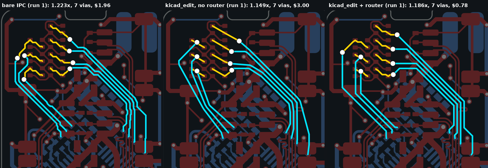
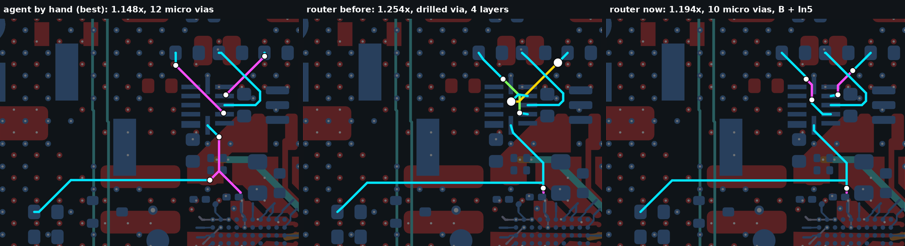

# The KiCad-IPC token benchmark

What an agent spends to make a KiCad edit through Backplane, measured with real turns on a real headless KiCad
(`test/kipc_bench`, whose README says how to run it). Eight edits a person could ask for (move and rotate parts, set
schematic fields, a net class, place symbols, a track and a via, a zone, custom rules, fix a DRC finding), each on a
fresh copy of a demo project, each checked item for item against a reference edit.

## Result

Before: `kicad_ipc` alone (raw protobuf commands, a lock, a commit and a save by hand). After: `kicad_edit`
([kicad-edit.md](kicad-edit.md)), loaded up front in a design project. Model `claude-fable-5-2`, medium effort, medians
per task; before is 3 runs a task, after is 6 (2026-11-14, Backplane KiCad 10.99.0-bp.12.1).

| task | passes | context tokens | output tokens | tool calls | wall s | cost $ |
|---|---|---|---|---|---|---|
| move_rotate | 3/3 → 6/6 | 960,532 → 83,069 | 6,088 → 738 | 20 → 2 | 94 → 19 | 1.36 → 0.54 |
| sch_fields | 3/3 → 6/6 | 2,298,400 → 83,874 | 25,141 → 815 | 37 → 2 | 266 → 18 | 3.51 → 0.55 |
| netclass | 3/3 → 6/6 | 1,064,066 → 124,305 | 7,743 → 735 | 28 → 2 | 114 → 20 | 1.33 → 0.54 |
| sch_place | 3/3 → 6/6 | 1,947,974 → 83,310 | 12,226 → 895 | 34 → 2 | 180 → 20 | 1.95 → 0.55 |
| track_via | 3/3 → 6/6 | 518,367 → 103,591 | 3,119 → 734 | 15 → 2 | 68 → 19 | 0.80 → 0.54 |
| zone | 3/3 → 6/6 | 1,011,852 → 82,810 | 7,354 → 644 | 22 → 2 | 120 → 18 | 1.30 → 0.53 |
| rules | 3/3 → 5/5 | 912,537 → 124,135 | 5,659 → 728 | 24 → 2 | 91 → 19 | 1.11 → 0.54 |
| drc_fix | 3/3 → 4/4 | 582,287 → 127,124 | 3,148 → 992 | 15 → 3 | 65 → 25 | 0.85 → 0.58 |
| **all (sum of medians)** | 24/24 → 45/45 | 9,296,015 → 812,218 | 70,478 → 6,280 | 195 → 17 | 996 → 158 | 12.22 → 4.36 |

Context is input plus cache writes plus cache reads over the turn's requests: every request carries about 40 thousand
tokens of prompt and tool definitions, so the number of requests is what moves it. An edit is now two or three requests where it was 15 to 37.

Of the 48 runs after, 3 were cut short by the benchmark account's usage limit and are left out (rules 1, drc_fix 2);
the other 45 passed.

## Against editing the files directly

The same eight edits, the same check, made two ways on `claude-opus-5-5` (medium effort, 3 runs a task, medians, 2026-11-15,
Backplane KiCad 10.99.0-bp.12.1). Raw file: no MCP servers, so only the CLI's own file and shell tools, KiCad not running,
and the prompt's KiCad editing lines replaced by "edit the design files directly; kicad-cli runs DRC, ERC and upgrades"
(`KIPC_BENCH_NOMCP=1`, `KIPC_BENCH_PROMPT=prompts/rawfile.json`). `kicad_edit`: the hub as on main at c6e665e62.

| task | passes | context tokens | output tokens | tool calls | wall s | cost $ |
|---|---|---|---|---|---|---|
| move_rotate | 2/3 → 3/3 | 369,533 → 129,959 | 4,377 → 820 | 8 → 2 | 55 → 17 | 0.45 → 0.30 |
| sch_fields | 3/3 → 3/3 | 197,422 → 175,408 | 2,178 → 846 | 4 → 3 | 24 → 16 | 0.34 → 0.32 |
| netclass | 2/3 → 3/3 | 152,271 → 173,360 | 1,710 → 875 | 3 → 3 | 22 → 17 | 0.30 → 0.31 |
| sch_place | 3/3 → 3/3 | 377,440 → 218,546 | 3,705 → 1,142 | 8 → 4 | 55 → 22 | 0.44 → 0.33 |
| track_via | 3/3 → 3/3 | 190,989 → 129,351 | 1,766 → 644 | 4 → 2 | 25 → 15 | 0.31 → 0.29 |
| zone | 2/3 → 3/3 | 371,014 → 129,334 | 3,384 → 698 | 8 → 2 | 46 → 15 | 0.43 → 0.29 |
| rules | 3/3 → 3/3 | 149,312 → 173,160 | 1,237 → 872 | 3 → 3 | 19 → 16 | 0.28 → 0.31 |
| drc_fix | 3/3 → 3/3 | 153,117 → 177,398 | 1,153 → 1,170 | 3 → 3 | 19 → 22 | 0.29 → 0.33 |
| **all (sum of medians)** | 21/24 → 24/24 | 1,961,098 → 1,306,516 | 19,510 → 7,067 | 41 → 22 | 265 → 141 | 2.84 → 2.48 |

The three raw file runs that failed each said they were done. Two are wrong edits: a net class with via sizes nobody asked
for (netclass 1), and J9 rotated in the file so that its pads no longer match its library footprint (DRC
`lib_footprint_mismatch`, move_rotate 1). The third is a difference, not a mistake: zone 1 refilled with `kicad-cli pcb drc
--refill-zones --save-board`, and that fill has no clearance finding where the reference's fill (KiCad's refill over IPC)
has one. Raw file editing wins on the small edits that are one block of text (netclass, rules, drc_fix); `kicad_edit`
on the ones that need geometry or KiCad's own rules (rotating a part, a zone refill, placing a symbol). The raw file prompt
is shorter and carries no MCP tool definitions, so each of its requests reads a little less: the context gap is a floor.

These are Opus 5.5 numbers; the tables above are Fable 5.2, so compare within a table, not across them.

## Design work (pilot, 1 run a task)

Realistic edits, where many results are right, so a run is held to rules written before any run (`checks.py`), not to
one reference: DRC and ERC with nothing new, the netlist, the spec's places and widths, and nothing else moved. Fixtures
from `mkfix2.py` (`tasks2.json`; `KIPC_BENCH_TASKS` picks the task file): `sch_ldo` (an AMS1117 with its caps and power
symbols laid out in a free area of pic_programmer's root sheet), `route_leds` (StickHub's seven LED nets taken up: a net
class, the routes, a refill), `place_decap` (eight decoupling caps parked off StickHub, placed again within 2 mm of their
U1 pins), `swap_fp` (nine pic_programmer footprints to a shorter pitch, schematic and board, re-routed), `hubble_route`
(four debugger nets on a copy of Hubble_DK, an 8-layer board part way routed). Opus 5.5, medium effort, 2026-11-15,
one run a task each way, so read it as a first look, not a median.

| task | raw file | `kicad_edit` |
|---|---|---|
| sch_ldo | pass, 1,446,190 tok, 26 calls, 214 s, $1.02 | pass, 2,238,997, 37, 165 s, $1.27 |
| route_leds | pass, 1,071,396, 20, 161 s, $0.96 | pass, 2,298,611, 27, 408 s, $1.58 |
| place_decap | fail, 3,247,644, 42, 584 s, $2.04 | pass, 1,914,940, 25, 389 s, $1.52 |
| swap_fp | pass, 1,553,667, 23, 247 s, $1.45 | pass, 8,019,421, 60, 640 s, $5.38 |
| hubble_route | pass, 1,330,239, 20, 257 s, $1.47 | pass, 1,995,058, 19, 272 s, $2.04 |
| **all** | 4/5, 8,649,136, 131, $6.94 | 5/5, 16,467,027, 168, $11.79 |

What the transcripts show:

- The cost is geometry, and both sides pay it the same way: Python over the board file (one `kicad_edit` route_leds run
  installed shapely, drew the area to a PNG and looked at it) and `kicad-cli pcb drc`, 14 to 28 shell calls a task on
  either side. `kicad_edit`'s rows have no shapes (pad sizes, track outlines, courtyards), so the agent reads the file
  anyway and then also pays for the tool.
- `kicad_edit` has no footprint swap: swap_fp fell back to raw `kicad_ipc` (ImportNetlist, PlaceFootprintFromLibrary,
  UpdateItems in chunks) and read the API's proto sources: 8 M tokens.
- Setting a symbol's Footprint field through `kicad_edit` took the agent four tries.
- The raw place_decap failure ended its turn while a search it had started in the background ran; in a thread it would be
  woken and go on, a benchmark turn ends there.
- Runs share `/tmp`, and an agent's memory notes land in the login's Claude folder (one wrote a "footprint swap method"
  note); each run's folder has its own name, so no run read another's, but run them with that in mind.

## Design work, against editing the files directly

Five tasks a designer would give (`test/kipc_bench/tasks2.json`), each held to rules, not to one reference, since many
results are right (`checks.py`: KiCad's DRC or ERC with nothing new, every net connected, the spec's places and widths,
nothing else moved): add a 3.3 V regulator with its two capacitors and power symbols to a schematic, laid out in a given
area (`sch_ldo`); add a net class and route seven nets at its width, pours refilled (`route_leds`); place eight
decoupling capacitors each within 2 mm of its pin (`place_decap`); change nine footprints in schematic and board, pad 1
kept, and re-route what the shorter parts leave (`swap_fp`); route four nets on a copy of Hubble_DK, a real 8-layer HDI
board part way through routing (`hubble_route`). `claude-opus-5-5`, medium effort, medians per task (2026-11-15,
Backplane KiCad 10.99.0-bp.12.1). Raw file: 3 runs a task, no MCP servers, the prompt's KiCad lines replaced as above.
`kicad_edit` before: main at c6e665e62, 2 runs. `kicad_edit` now: what landed (variant v3 below), 2 runs.

| task | passes raw / before / now | context tokens | tool calls | wall s | cost $ |
|---|---|---|---|---|---|
| sch_ldo | 3/3 / 2/2 / 2/2 | 1,446,190 / 1,934,540 / 156,413 | 26 / 32 / 2 | 174 / 150 / 30 | 1.02 / 1.16 / 0.38 |
| route_leds | 3/3 / 2/2 / 2/2 | 1,419,475 / 1,771,720 / 132,148 | 22 / 22 / 2 | 215 / 280 / 21 | 1.19 / 1.36 / 0.35 |
| place_decap | 1/3 / 2/2 / 2/2 | 3,247,644 / 2,445,002 / 133,438 | 42 / 28 / 2 | 584 / 658 / 29 | 2.04 / 1.79 / 0.31 |
| swap_fp | 3/3 / 2/2 / 2/2 | 1,700,905 / 9,261,947 / 205,586 | 26 / 70 / 4 | 247 / 803 / 39 | 1.45 / 5.96 / 0.36 |
| hubble_route | 3/3 / 2/2 / 2/2 | 1,876,724 / 2,747,482 / 191,578 | 24 / 25 / 3 | 280 / 350 / 56 | 1.76 / 2.31 / 0.39 |
| **all (sum of medians)** | 13/15 / 10/10 / 10/10 | 9,690,938 / 18,160,692 / 819,162 | 140 / 178 / 14 | 1,501 / 2,242 / 176 | 7.46 / 12.59 / 1.79 |

Against raw file editing that is 92% fewer context tokens, a tenth of the tool calls, an eighth of the time and a
quarter of the cost, with every run passing (raw: two of three placement runs said done with the capacitors still off
the board). Before this, `kicad_edit` lost to raw files on this work by a factor of two: it could write a track but not
find one, so the agent still parsed the board file, wrote a clearance search in Python (with shapely, in a venv it made),
ran DRC by hand, and for a footprint exchange fell back to forty raw `kicad_ipc` calls. What changed is in
[kicad-edit.md](kicad-edit.md), "The geometry is the hub's": `route`, `place`, a footprint exchange, schematic groups
whose pins join their nets and which find their own free room, and KiCad's own check in the answer.

Two runs a task is few: the per-task medians of `now` moved by up to 60 thousand tokens between variants that did not
touch that task (one request more or less). The total is not in doubt; the order of v3 and v4 below is.

### What was tried (design tasks)

| variant | what | passes | context tokens | tool calls | wall s | cost $ | kept |
|---|---|---|---|---|---|---|---|
| raw | the agent edits the files, no KiCad tools | 13/15 | 9,690,938 | 140 | 1,501 | 7.46 | |
| before | `kicad_edit` as on main at c6e665e62 | 10/10 | 18,160,692 | 178 | 2,242 | 12.59 | |
| v1 | `route` (a grid router at the net class's width and clearance), `place` (next to a pin), footprint exchange, a new symbol's `pins` joined to nets, wires by pin, DRC/ERC before and after in the answer, the new parts' nets | 10/10 | 1,270,746 | 22 | 233 | 2.10 | yes |
| v2 | v1 + `fit: [area]` moves a new schematic group to free room when asked; a part named in `route` has other nets' tracks taken off its pads and routed again | 10/10 | 1,684,902 | 29 | 296 | 2.32 | the reroute (swap_fp 370k to 328k); `fit` only on request, no: the agent did not ask, rendered the sheet to look for room and moved texts by hand (sch_ldo 435k to 866k) |
| v3 | v2 + a new group moves to free room by itself and says so, a moved symbol takes its texts, the check runs with schematic parity and names itself | 10/10 | 819,162 | 14 | 176 | 1.79 | yes (landed) |
| v4 | v3 + a prompt line: "this project folder has no AGENTS.md ... nothing to read or list before you start" (`prompts/noagents.json`, not built in) | 10/10 | 788,506 | 12 | 180 | 1.79 | no: 4% is inside the noise of two runs, hubble_route went up (192k to 314k), and the line would have to be true of every project |

Also tried and not used: the fork's own router over IPC (`kiapi.backplane.SketchRoute`, KiCad's PNS). It runs headless
and is fast (seven nets in 0.07 s) but routed at the board's default width, not the net class's, left one of seven
nets unrouted and cut a pour (`test/kipc_bench/repros/README.md`, 8). The hub's own router is what `route` uses.

What a run still spends: every turn's first request lists the folder and looks for an AGENTS.md (the model's habit, not
the prompt's asking), about 43 thousand tokens; then one request per `kicad_edit` call and one to answer. A task is
two to four requests, so the floor is near 90 thousand tokens a task until the prompt and tool definitions shrink.

## Routing three ways: bare IPC, `kicad_edit` without its router, `kicad_edit` with it

Is the hub's router worth having, or would the model do as well with the API alone? Three routing tasks (`tasks3.json`:
`route_leds`, `hubble_route`, and `route_drv`: seven three-pad nets across StickHub, a bottom-side resistor to both pads
of a top-side LED, one via each), `claude-fable-5-2`, medium effort, two runs a task and variant, three hubs side by side
(2026-11-15). (a) only raw `kicad_ipc`, the prompt's KiCad lines as before `kicad_edit` (`prompts/bareipc.json`,
`KIPC_BENCH_DISALLOW`); (b) a build of `kicad_edit` that refuses `route` and `place` and does not describe them, so the
model places tracks and vias through `add`; (c) main at 444bba150. Each run is scored by `h2h.py`: the rule check, each
net's track length against the shortest tree over its pads, vias, layers, bends, acute corners, KiCad's DRC, and the
clearance the new copper keeps over the rule (KiCad's own DRC asked again with a custom rule at the rule plus 0.01 to
0.2 mm, pours left out); and its tool calls are read back (`h2h.py trace`).

| variant | passes | context tokens | tool calls | wall s | cost $ |
|---|---|---|---|---|---|
| (a) bare IPC | 6/6 | 7,712,656 | 104 | 1,118 | 11.07 |
| (b) `kicad_edit`, no router | 6/6 | 3,128,876 | 40 | 752 | 8.19 |
| (c) `kicad_edit` with the router | 6/6 | 538,136 | 11 | 149 | 2.35 |

| task | variant | context | calls | wall s | cost $ | length / shortest tree | vias | layers | bends | margin over the rule mm |
|---|---|---|---|---|---|---|---|---|---|---|
| route_leds | a / b / c | 2,246,439 / 500,117 / 113,602 | 33 / 6 / 2 | 321 / 197 / 28 | 3.29 / 2.24 / 0.69 | 1.06-1.09 / 1.07 / 1.057 | 0 | B | 12-16 / 13 / 19 | 0.01 |
| route_drv | a / b / c | 2,212,983 / 1,209,613 / 91,074 | 32 / 18 / 2 | 336 / 258 / 28 | 3.14 / 2.85 / 0.69 | 1.22-1.23 / 1.15-1.26 / 1.186 | 7 | B, F | 49-190 / 43-55 / 52 | 0 |
| hubble_route | a / b / c | 3,253,234 / 1,419,146 / 333,460 | 40 / 16 / 7 | 461 / 297 / 93 | 4.65 / 3.09 / 0.97 | 1.38-1.44 / 1.15-1.17 / 1.254 | 12 / 8-12 / 6 | B, In5 / B, In5 (In6) / B, F, In5, In6 | 18-20 / 11-12 / 13 | 0.01 / 0-0.025 / 0 |

Every run passed and no run left a DRC finding on its nets; nobody leaves clearance to spare. The routes are alike in
length. What differs is the price: without a router the model builds one. What the traces show:

- (a) is not router-free. One `route_drv` run loaded KiStack's layout skill, found
  `layout-placement/scripts/grid_router.py` (a placement check) and routed with it (190 bends); the other called the
  fork's `SketchRoute`: "The auto-router connected 6 of the 14 links ... I'm now drawing the LED area to hand-route the
  remaining 8." Every run parses the board file with a parser it writes (7 to 12 reads of the file, the first try
  crashing more often than not), renders the area to a PNG and reads it back (single tool results of 110 to 307
  thousand characters), and misuses the API two to eight times a run (`GetOpenDocuments` before a document is open,
  `GetNetClasses` without a project, wrong field names).
- (b) writes a router for anything but the shortest nets: "Fixing a small bug in my routing script, then computing the
  seven routes" (a `route.py` with `heapq` and numpy, 7,500 characters). It still reads the board file for pad shapes
  (`find` gave centres only), and one `find` near a point answered 52,966 characters, more than a tool result may be.
  Its commits are one batched `add` and need no retry, and it takes the DRC in the answer at its word. Its tracks run at
  any angle, which KiCad's check passes and a designer would not draw.
- (c) is one call a task on StickHub. On Hubble it cost six to eight calls, and the routes were the worst of the three
  to look at: a drilled via under the level shifter up to the top layer, on a board of laser micro vias, and the
  check's `new` list named two findings on other nets that a refill had only moved ("I'm now checking that the two
  'new' unconnected reports on other nets (/FEM.MD, /I2C.SCL) were already there before my edit").

### What was fixed after it (no model runs; unit tests and the no-model end-to-end run)

| what | before | now |
|---|---|---|
| Hubble's four nets (`route` by hand, `h2h.py quality`) | 1.254 x the shortest tree, 6 vias (drilled, under U9), B, F, In5, In6, 13 bends | 1.194 x, 10 laser micro vias as the board's own, B and In5 only, 14 bends; the agents' best by hand was 1.148 x with 12 |
| route_drv | 1.186 x, 52 bends | 1.212 x, 49 bends |
| route_leds | 1.057 x, 19 bends | 1.065 x, 15 bends |
| the check's `new` on Hubble | two findings on nets the edit did not touch | none: the same finding with another length, place or item order is the same finding, and one on items the edit did not work on is counted under `elsewhere` |

- The router follows the board: a via kind costs by how rare it is on the board (a drilled via on a board of micro
  vias), a drilled via under a part of eight pads or more costs more, a layer the board hardly routes on costs a
  quarter more, a plane layer is open to a stack of micro vias passing through and, at two and a half times the
  length, to a track with no other way; a track takes a little room over its clearance where there is room; and the
  grid's small steps are pulled into straight runs at 0, 45 and 90 degrees, no corner sharper than a right angle.
- A new track that ends part way along another of its net breaks that track there (KiCad's check calls an end on the
  middle of a track dangling); after a footprint exchange, the old track's end where the pad stood is cut back to
  where it still joins something.
- `find` stops at about 24 thousand characters and says how many rows are left; a pad's row has its copper's size,
  turn and layer.
- `kicad_ipc`: `GetOpenDocuments` opens the document when none is open (headless), and a project command sent without
  a project is asked again with the document's own.
- KiStack (2c6b542): the layout skill said to route by hand and never to use a router; it now says to route with
  `kicad_edit`'s `route`, and layout-placement says its `grid_router.py` checks a placement and does not route a board.

The fork's router again, with its fixes (`SketchRoute` on the staged runtime 10.99.0-bp.13-apifix-dd9396cfd1, by hand,
2026-11-16, `route_leds` after the net class is set): it now routes at the class's 0.2 mm and names each failure
("no path keeps every clearance, after rip-up and retry"), in 0.09 s; it routed 5 of the 7 nets (`/LED2` and `/LED6`
failed), at 1.323 x the shortest tree with 2 vias and the top layer, and left a solder mask bridge. The hub's router
on the same board: 7 of 7, 1.065 x, no via, DRC clean, 4.5 s for the whole call with its two DRC runs. So `route`
stays on the hub's router, and `sketch-route-width` switches nothing.

### The fork's API fixes and the hub's way by capability (batch 10)

Run by the fork's integrator (2026-11-16): `tasks2.json`, `claude-opus-5-5`, 2 runs a task, 30 runs, every one
passing. c1: the batch 9 runtime (6a227fdd28) with main at 0c2569811; c2: the runtime with the fixes (d05f93cea6:
`api-field-fixes`, `sketch-route-width`) with the same main; c3: that runtime with the hub's way by capability
(kipc-caps 337d085b2: a new symbol as its library id and texts, Footprint a field by name, a footprint's value as
that one field). One checker `kicad-cli` (d05f93cea6) for all three.

| | passes | context tokens | tool calls | wall s | cost $ |
|---|---|---|---|---|---|
| c1 old runtime, main | 10/10 | 1.07M | 19 | 178 | 1.93 |
| c2 new runtime, main | 10/10 | 1.22M | 22.5 | 191 | 1.90 |
| c3 new runtime, by capability | 10/10 | 1.24M | 23 | 181 | 1.87 |

No change outside the model's own variance at two runs (the spread is whether the agent checks its work afterwards:
`sch_ldo` ran from 2 to 11 calls inside one column), and a `kicad_edit` call takes as long on both ways (KiCad's
placement of a new symbol is read on both, for its pins). c3 did take the new way: its regulator's Footprint text sits
where the library puts it. What the fixes buy is a simpler hub path on new runtimes and right results for raw
`kicad_ipc`; the workarounds had already made `kicad_edit` right. SketchRoute still loses `route_leds` (5 of 7 nets,
1.32 x, 2 vias) to the hub's router (7 of 7, 1.065 x).

## A cheap model in Backplane against an expensive one without it (Grok 4.7, Fable 5.2)

The five design tasks, the same prompts and rule checks, four cells side by side on four hubs (2026-11-16, main at
3552c7cfd, Backplane KiCad 10.99.0-bp.12.1): `grok-4.7` (the newest model of Grok CLI 1.0.77) and `claude-fable-5-2`,
each in Backplane (`kicad_edit` on main) and editing the files with no KiCad tools (no MCP server, the prompt's KiCad
lines replaced: `prompts/rawfile.json`). Medium effort. **One run a cell and task**: the second round was not run (the
first used the $40 this was given, and Grok's plan balance ran out during it), so these are single runs and the
per-task figures carry one run's luck.

Cost is each provider's list price for the tokens the CLI reports, not what was paid (both CLIs ran on a
subscription): Claude's is the CLI's own figure; Grok's is xAI's price for `grok-4.7` under 200k prompt tokens ($2.00
input, $0.50 cached input, $6.00 output per million; docs.x.ai/docs/models), which matches the CLI's own
`grok usage <session>` to the cent ($1.03 on the trial run).

| cell | passes | context tokens | tool calls | wall s | cost $ | cost per passed task $ |
|---|---|---|---|---|---|---|
| Grok 4.7 in Backplane | 5/5 | 7,535,851 | 195 | 1,747 | 5.53 | 1.11 |
| Grok 4.7, raw files | 3/4 | 30,423,580 | 440 | 5,157 | 19.63 | 6.54 |
| Fable 5.2 in Backplane | 5/5 | 745,830 | 15 | 227 | 3.27 | 0.65 |
| Fable 5.2, raw files | 5/5 | 4,524,086 | 73 | 1,155 | 10.32 | 2.06 |

| task | Grok 4.7 in Backplane | Grok 4.7, raw files | Fable 5.2 in Backplane | Fable 5.2, raw files |
|---|---|---|---|---|
| sch_ldo | pass, 1.07M, 37 calls, 438 s, $1.00 | pass, 8.86M, 123 calls, 1,299 s, $5.50 | pass, 0.14M, 2 calls, 40 s, $0.66 | pass, 0.59M, 12 calls, 226 s, $1.31 |
| route_leds | pass, 0.95M, 28 calls, 168 s, $0.64 | pass, 8.45M, 117 calls, 1,199 s, $5.24 | pass, 0.09M, 2 calls, 26 s, $0.59 | pass, 0.75M, 14 calls, 207 s, $2.01 |
| place_decap | pass, 2.65M, 53 calls, 465 s, $1.75 | FAIL, 6.49M, 96 calls, 1,358 s, $4.60 | pass, 0.09M, 2 calls, 36 s, $0.61 | pass, 0.65M, 11 calls, 116 s, $1.54 |
| swap_fp | pass, 2.61M, 67 calls, 566 s, $1.86 | pass, 6.62M, 104 calls, 1,302 s, $4.29 | pass, 0.29M, 7 calls, 78 s, $0.81 | pass, 1.07M, 15 calls, 250 s, $2.44 |
| hubble_route | pass, 0.27M, 10 calls, 109 s, $0.27 | not run: the plan's balance ran out 65 s in (HTTP 402) | pass, 0.14M, 2 calls, 46 s, $0.60 | pass, 1.46M, 21 calls, 356 s, $3.03 |

(On the four tasks every cell ran: Grok in Backplane 4/4 at $1.31 a pass, Grok raw 3/4 at $6.54, Fable in Backplane 4/4
at $0.67, Fable raw 4/4 at $1.82.)

What it says, at one run a cell:

- The cheap model in Backplane beat the expensive model without it: Grok with `kicad_edit` passed 5 of 5 at $1.11 a
  passed task; Fable editing the files passed 5 of 5 at $2.06.
- Backplane is worth more to Grok than to Fable: Grok's cost a passed task falls about six times ($6.54 to $1.11) and
  its one failure goes away; Fable's falls about three times ($2.06 to $0.65).
- The cheap model is not the cheap way here. Grok's token price is a fraction of Fable's, but it reads ten times the
  tokens: in Backplane Grok cost more a task than Fable ($1.11 against $0.65) and took eight times as long. Without
  Backplane it was the dearest cell of the four: 96 to 123 tool calls and 20 minutes a task.

What the traces show (`h2h.py trace` reads Claude's logs; Grok's ACP lines were read by hand):

- Grok in Backplane does the work in one or two `kicad_edit` calls, right first time (`netclass` + `route`; `place`;
  one `add` with `pins`; `route` on Hubble: the same calls Fable makes). The rest of its 10 to 67 calls go before and
  after. Before: its MCP tools sit behind its own `search_tool` / `use_tool`, the search returns `kicad_edit`'s whole
  description, and it still looks for more: 15 to 51 calls a task grepping the disk and pulling strings out of the
  hub's binary ("Extract netclass op text from hub binary"; it found this benchmark's own scratch folders and read
  them). After: it follows the prompt's "read back the saved path, show it, verify the viewer and history" to the
  letter (up to 24 calls on the trial run: the board file, the project file, the history repository) and reports that
  "the show call came back with `settled: false`".
- Grok on raw files reads and greps: 43 greps, 35 file reads and 32 shell commands to route seven nets, the board
  file read back in pieces of 30 to 145 thousand characters. It wrote small geometry scripts (two to six a task), and
  on placement it said it was done ("no capacitor pad touches copper of another net") with two pads short of their
  clearance to a via and a track.
- Fable is the same as in the tables above: two calls a task in Backplane (seven for the footprint exchange), and on
  raw files a parser and a search of its own each time (11 to 21 calls).
- The harness, for Grok: the hub drives it as it does a Grok thread (`grok agent stdio`, ACP, Backplane's MCP server in
  the session), through `test/kipc_bench/grok`, which copies the lines and, for the raw cell, gives the session no MCP
  server. Grok signs in from the person's `~/.grok`, so its own configured MCP servers are there in every cell and its
  sessions are kept there. It searches the disk for answers, so a finished run's folder is closed to it
  (`KIPC_BENCH_SEAL`).

Open: why Grok does not trust the tool description it was handed (a shorter first answer from its tool search, or the
ops as a schema it can check against, may save most of its calls), and a second run a cell.

## What was tried

| variant | what | passes | context tokens | tool calls | cost $ |
|---|---|---|---|---|---|
| base | `kicad_ipc` as it was | 24/24 | 9,296,015 | 195 | 12.22 |
| forgiving | `kicad_ipc` takes a free lock, opens its document, completes short command names | 21/24 | 7,720,497 | 158 | 11.31 |
| edit | `kicad_edit` behind the tool search | 24/24 | 1,684,672 | 44 | 5.27 |
| edit3 | `kicad_edit`, its tool description and prompt lines reworded | 23/24 | 995,162 | 18 | 4.43 |
| edit4 | a change answers with the items as they are | 24/24 | 957,096 | 18 | 4.44 |
| edit4n | loaded up front (no tool search) | 24/24 | 791,617 | 17 | 4.42 |
| final | what landed | 45/45 | 812,218 | 17 | 4.36 |

## Found on the way

- A hub's KiCad server that answered its first Ping with "not ready to reply" was marked failed; it is now asked again
  for up to 30 s (`kicad/ipc.rs`, `READY_WAIT`).
- A hub whose stderr reader had gone stopped at its next "kicad ipc: up" line and never handed the server its requests
  (the benchmark's stall); that line can no longer stop the handshake.
- Two KiCad API defects, written up for the fork with scripts: `test/kipc_bench/repros/README.md`; the design tasks added three more there (a symbol that extends another, a Footprint user field, SketchRoute's width).
- A real turn of the benchmark writes Claude's own memory files under the login's `~/.claude/projects/<run folder>/memory` (one pilot run saved a note there): the wrapper gives the CLI the person's login folder. Harmless to the results (each run's folder is its own); worth a config folder of its own next time.
