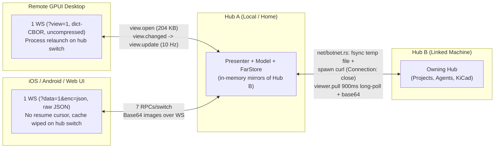
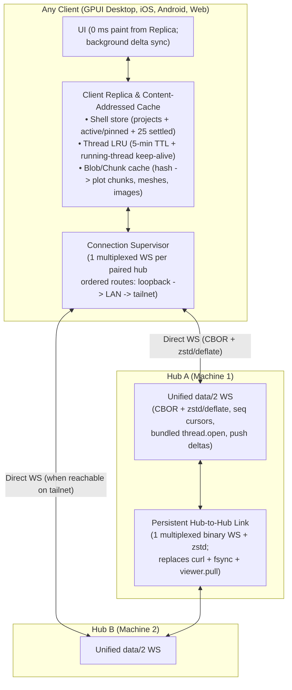

# Remote & Multi-Machine Architecture Proposal

> Status: **Approved — being built in phases (Phase 0: hub and clients).**
> Measured against Backplane `b523f965ef` (`native/host`, `native/gpui`, `mobile/ios`, `web/`) and compared with T3 Code (`pingdotgg/t3code`).

## 1. Summary

Remote Backplane sessions (a linked desktop app, a phone, or the web UI over Tailscale) feel slow because of four compounding structural issues:

1. **No client-side state replica or resume cursor.** Switching threads or reconnecting discards state and re-fetches full views or full RPC waterfalls from scratch. Switching hubs in the desktop app (`native/gpui/src/hubs.rs`) relaunches the entire OS process.
2. **Uncompressed, redundant wire payloads.** Neither `?view=1` (desktop CBOR) nor `?data=1&enc=json` (phone/web JSON) negotiates WebSocket compression (`permessage-deflate` or `zstd`). In `?view=1`, `view.open` explicitly clears the delta history (`c.sent.clear()` in `native/host/src/session/mod.rs:184`), forcing a **204 KB** full-screen resend on every single thread switch. In `?data=1`, cold connect downloads both `threads.list` (43 KB) and `sidebar.sections` (29 KB) uncompressed.
3. **Serialized round-trips and uncached server work.** Opening a thread on `data/1` fires **7 sequential RPCs** (`subscribe`, `thread.entries`, `thread.work`, `thread.queue`, `thread.picker`, `thread.buy`, `viewer.rail`). `thread.buy` runs an uncached `fab.look` taking **~482 ms** on every open/switch. Streaming replies on `?view=1` perform a 1.5-RTT poll loop (`view.changed` -> `view.update` -> full view re-render + diff) at 10 Hz.
4. **Subprocess-per-call hub-to-hub transport.** Linked-machine calls (`/far/rpc`, `/far/log`, `/far/push`, `viewer.pull`) in `native/host/src/net/botnet.rs` write the request body to a `0600` temp file with `fsync()`, spawn a fresh `curl` process with `Connection: close`, and long-poll binary board plots as **base64 inside JSON** (+33% bloat).

Applying T3 Code's multi-machine architecture plus first-class wire-data minimization cuts typical remote interactions by **85–97% in wire bytes** and turns thread/machine switches into **0 ms instant cached paints** (with <1-RTT background delta sync).

---

## 2. How Backplane Works Today

### 2.1 Current Topology & Protocols

Backplane currently maintains **three separate remote protocols** with different trade-offs and no shared client-side replica:

### 2.2 Where Time and Bytes Go (Root Causes in Code)

| Area | Current Behavior | Code Location |
|---|---|---|
| **Hub switching (Desktop)** | Rewrites `hubs.json` and **relaunches the GPUI binary** (`Command::new(&app)`). Only one hub connection exists at a time. | `native/gpui/src/hubs.rs`, `native/gpui/src/main.rs:132` |
| **Hub switching (iOS/Android)** | `reset()` clears all memory state and **deletes the disk cache file** before reconnecting cold. | `mobile/ios/Backplane/DataClient.swift:234-239` |
| **Thread switching (GPUI `?view=1`)** | `Command::Select` clears `view_id` and sends `view.open`. Hub runs `if m == "view.open" { c.sent.clear(); }`, defeating `viewDelta` and resending the entire sidebar + thread tree (~204 KB) every switch. | `native/gpui/src/hub.rs:228`, `native/host/src/session/mod.rs:184` |
| **No-op / streaming updates (`?view=1`)** | Hub sends `view.changed` -> GPUI sends `view.update` -> hub re-renders full view & diffs. Even an unchanged `view.update` emits **11.8 KB / 20 delta ops**. Streaming at 10 Hz costs 1.5 RTTs + full re-render per tick. | `native/host/src/wire/mod.rs:175-245`, `native/host/src/delta.rs` |
| **Thread switching (`data/1`)** | Fires `unsubscribe` + `subscribe` + `thread.entries` + `thread.work` + `thread.queue` + `thread.picker` + `thread.buy` + `viewer.rail` (7–8 RPCs). No `sinceSeq` resume; returning to a thread reloads all 40 entries. | `mobile/ios/Backplane/DataClient.swift:675-690`, `web/src/app.ts:795-860` |
| **Uncached `thread.buy`** | Calls `fab.look` on every thread open/switch, taking **~482 ms** on a KiCad project even when nothing changed. | `native/host/src/data/ext.rs:295-296` |
| **Duplicate sidebar data (`data/1`)** | Cold connect fetches both `threads.list` (43 KB) and `sidebar.sections` (29 KB) uncompressed, plus `open_ask_counts()` scans 4,000 log lines and `thread_json()` pages `events.jsonl` per thread for previews. | `native/host/src/data/mod.rs:63-91` |
| **Viewer / board payloads** | `viewer.watch` explicitly resets per-connection held chunks on every open ("Each watch starts afresh"). Leaving and re-opening an unchanged board resends 100% of plot chunks. | `docs/PHONE-DATA.md:98`, `native/host/src/kicad/plot.rs` |
| **Images & attachments** | `message.image` and `attachment.get` send up to 8 MiB as **base64 inside JSON** over the WebSocket (+33% bloat, no content-addressed cache). | `mobile/ios/Backplane/DataClient.swift:929-935` |
| **Subagent drill-down** | `subscribe {topic: "sub"}` pushes the **entire `sub_view`** (up to 300 entries) on every step. | `docs/PHONE-DATA.md:149` |
| **Hub-to-hub `/far/*`** | Every RPC writes a `0600` temp file with `fsync()`, spawns `curl` with `Connection: close`, sends uncompressed JSON. `viewer.pull` long-polls every 900 ms and base64-encodes binary CBOR plots inside JSON. Live streamed text is dropped (`farsync.rs:110`). | `native/host/src/net/botnet.rs:68-90`, `native/host/src/net/farview.rs:51-64`, `native/host/src/net/farsync.rs:110` |
| **WebSocket compression** | **None.** Neither `wire/mod.rs` nor `data/mod.rs` enables `permessage-deflate` or `zstd` framing. | `native/host/src/wire/mod.rs:201`, `native/host/src/data/mod.rs` |

---

## 3. Measured Baseline (Step 2)

### 3.1 Methodology

- **Setup:** Headless `backplane-hub` (`b523f965ef`) on a synthetic home (15 projects, 120 threads: 15 pinned, 35 active, 70 settled; two 50-message/50-tool-call threads `t000` and `t001`; one KiCad project containing `ecc83-pp.kicad_pcb` and `ampli_ht.kicad_sch`).
- **Client machine:** Headless Python RFC-6455 WebSocket + dict-CBOR/JSON client running on a second machine over Tailscale direct LAN (**14 ms RTT** measured via `tailscale ping`).
- **WAN / Cellular projections:** Derived from measured direct WAN Tailscale RTT to a cloud VM (**81 ms RTT**) and typical DERP / mobile LTE (**150 ms RTT**).
- **Compression reference:** Exact `zlib` (level 6, equivalent to `permessage-deflate`) measured on the captured raw RX payloads.

### 3.2 Measured Numbers: Latency & Bytes per Action

| Action | Protocol | RPCs / RTTs | Measured Latency (14 ms LAN) | Projected WAN (81 ms) | Raw Wire RX | `gzip`/`deflate` RX | Compression Ratio |
|---|---|---:|---:|---:|---:|---:|---:|
| **Cold connect (`hello`)** | `data/1` JSON | 1 WS + 1 | 16.4 ms | ~165 ms | 1,473 B | 709 B | 2.1x |
| **Cold sidebar / lists** | `data/1` JSON | 6 RPCs | 65.4 ms | ~520 ms | **81,005 B** | 5,210 B | **15.5x** |
| **Cold sidebar (`threads.list` only)** | `data/1` CBOR | 1 RPC | 26.6 ms | ~100 ms | 32,489 B | 1,962 B | 16.6x |
| **Open thread `t000` (KiCad project)** | `data/1` JSON | 7 RPCs | **528.7 ms** *(481.7 ms `thread.buy`)* | **~1,060 ms** | **16,848 B** | 2,612 B | **6.5x** |
| **Switch `t000` -> `t001` (non-KiCad)** | `data/1` JSON | 8 RPCs | 68.5 ms | ~660 ms | 17,014 B | 2,656 B | 6.4x |
| **Switch back `t001` -> `t000`** | `data/1` JSON | 8 RPCs | **546.3 ms** *(487.0 ms `thread.buy`)* | **~1,140 ms** | **16,894 B** | 2,667 B | 6.3x |
| **Cold connect + `view.open(recent)`** | `view=1` CBOR | 1 WS + 1 | 95.8 ms | ~250 ms | **157,188 B** | 14,119 B | **11.1x** |
| **Open thread `t000` (`view.open`)** | `view=1` CBOR | 1 RPC | 76.9 ms | ~150 ms | **204,205 B** | 23,890 B | **8.5x** |
| **Switch `t000` -> `t001` (`view.open`)** | `view=1` CBOR | 1 RPC | 60.3 ms | ~135 ms | **204,622 B** | 24,011 B | **8.5x** |
| **Switch back `t001` -> `t000`** | `view=1` CBOR | 1 RPC | 56.7 ms | ~130 ms | **204,350 B** | 23,928 B | **8.5x** |
| **No-op `view.update` (0 changes)** | `view=1` CBOR | 1 RPC | 26.5 ms | ~95 ms | **11,762 B** *(20 ops)* | 1,899 B | 6.2x |
| **40-step streaming reply (4 s, 3 KB)** | `view=1` CBOR | 40 cycles (80 RTTs) | stalls >4s on WAN | stalls >8s on WAN | **~470+ KB** *(>=40 × 11.8 KB)* | ~76 KB | — |
| **40-step streaming reply (4 s, 3 KB)** | `data/1` JSON | 40 pushes (0 RTTs) | real-time | real-time | **~6.2 KB** | ~2.1 KB | 3.0x |
| **Viewer: Board 1st open (`ecc83-pp`)** | `data/1` CBOR | 1 RPC + push | 818.6 ms | ~890 ms | **18,003 B** | 8,713 B | **2.1x** |
| **Viewer: Board 2nd open (unchanged)** | `data/1` CBOR | 1 RPC + push | 819.0 ms | ~890 ms | **18,003 B** *(100% resent)* | 8,713 B | 2.1x |
| **Viewer: Schematic (`ampli_ht`)** | `data/1` CBOR | 1 RPC + push | 841.0 ms | ~910 ms | **81,728 B** | 37,941 B | **2.2x** |
| **Viewer: Schematic via `/far/rpc` pull** | JSON + base64 | long-poll | +24.6 ms/poll | +160 ms/poll | **108,972 B** *(+33%)* | 49,500 B | — |
| **Hub-to-hub `/far/rpc` (per call)** | `curl` + `fsync` | new TCP + close | **24.6 ms** *(vs 6.4 ms WS)* | **~175 ms** | JSON uncompressed | — | — |

*(Note: A real complex PCB like the KiCad "video" demo board is **528 KB** uncompressed CBOR — **~704 KB** over `/far/rpc` base64 — resent in full on every viewer re-open. On a real 1.8 GB / 2.5M-line `events.jsonl`, `open_ask_counts()` and per-thread `m.page()` preview scans add further server latency on `threads.list`.)*

---

## 4. What T3 Code Does Better (Step 1)

From `pingdotgg/t3code` (`packages/client-runtime`, `apps/server/src/orchestration-v2`, `docs/internals/{connection-runtime,remote,performance-regressions,environment-auth}.md`):

1. **Multi-environment connection supervisor (`packages/client-runtime/src/connection/`):**
   - Clients (web, desktop, mobile) maintain **one independent multiplexed connection per environment** in a shared `EnvironmentRegistry` + `EnvironmentSupervisor`. Switching machines or projects never relaunches the app or drops other machines' sockets.
   - Each environment holds an **ordered route list** (loopback -> LAN -> Tailscale -> relay). The driver picks the first working route, learns new LAN/tailnet routes from the server descriptor, and the supervisor probes better routes in the background to upgrade seamlessly without dropping a live session.
   - **Dead-socket detection** on wake/foreground: if a probe goes unanswered for 500 ms (2.5 s off-LAN), it hits the public descriptor over a fresh HTTP request; if the host answers while the socket is silent, the socket is replaced immediately.
2. **Separated Shell vs Thread-Detail Streams with Sequence-Cursor Resume:**
   - **Shell stream (`ShellStream.ts`):** Sends only active navigation rows (active + pinned + newest 25 settled threads; idle subagents and older settled threads omitted and counted per project). Reconnect sends `resumeFrom: lastSequence` + `knownProjectIdentities` SHA-256 digest: if the gap is `<= 1,000` events and `<= 8 MiB`, the server replies `{resumable: true}` (~200 B) and streams only missed deltas.
   - **Thread detail stream (`ThreadStream.ts`):** Bounded initial window (~1 MiB / 10 turns / 75–500 rows) with a `historyCursor` for lazy older pages. Resume replays up to 128 events / 1 MiB before falling back to a bounded snapshot.
   - **Wire slimming:** Omits raw command output, tool result bodies, and inline diffs at the wire boundary (loaded on demand when expanded); uses `compactIds` (ID table), `dedupeBodies`, and `deferWork` (collapse finished work groups until expanded).
   - **Separate live command output channel (`CommandOutputHub`):** Raw stdout/stderr never enters the event log or thread stream; it streams only when a user expands a running command row.
3. **Client-Side Replica, 5-Minute Idle Cache, and Running-Thread Keep-Alive (`state/shell.ts`, `state/threads.ts`):**
   - Mounted views share one live subscription; unmounting a thread retains its projected state and replay cursor in memory (and on disk for settled threads) for **5 idle minutes**, so back-navigation paints in **0 ms** and resumes with ~200 B.
   - Desktop keeps subscriptions mounted for **every currently running thread** across all enabled environments, so clicking a working thread needs zero replay.
   - Mobile uses **steady shells** (`steadyShells.ts`): cached rows paint on frame 1 and avoid jumping one-by-one as environments finish syncing.
4. **CI-Enforced Transfer Budgets (`TransferBudgetReport.integration.ts`):**
   - Every PR is gated on exact decoded/wire byte ceilings (e.g., idle thread resume `<= 200 B`, shell subscribe `<= 200 B`, short turn resume `<= 13 KB`, ordinary turn total wire `<= 7 KB`, `perMessageDeflate: true`).

---

## 5. Proposed Architecture (Step 3)

### 5.1 High-Level Design

### 5.2 Five Core Pillars

#### Pillar 1: One Multiplexed Connection per Machine (Zero Relaunch, Direct Tailnet)
- **Desktop (`native/gpui`), Phones, and Web** replace their single-hub connection with a **multi-hub `ConnectionSupervisor`** (modeled on T3 Code's `supervisor.ts` + `registry.ts`):
  - Keep one persistent WebSocket per enabled hub (this computer + paired tailnet machines).
  - Switching machines in the sidebar simply switches the active store view — **no GPUI process relaunch, no iOS cache wipe**.
  - **Ordered routes per hub** (loopback -> LAN -> Tailscale direct -> always-on relay): prefer direct tailnet connections to the owning hub whenever reachable, falling back to hub-to-hub forwarding only when a peer is behind NAT/reverse-tunnel.
  - **Dead-socket wakeup probe** on laptop/phone wake: 500 ms probe + `/hello` liveness check replaces dead sockets immediately instead of waiting 40 s for watchdog timeout.
- **Hub-to-hub transport (`native/host/src/net/`):**
  - Replace `net/botnet.rs`'s `fsync` temp file + `curl` subprocess + `Connection: close` with a **persistent multiplexed binary WebSocket (CBOR + zstd)** per linked peer (authenticated with the existing HMAC peer secret at upgrade).
  - Eliminates the 24.6 ms/call `curl`+TCP overhead, eliminates `viewer.pull`'s 900 ms long-poll + base64 bloat, and enables live streamed text (`live` deltas) across linked machines (`farsync.rs:110`).

#### Pillar 2: Unified Protocol (`data/2` negotiated via `hello.features`) with Sequence Cursors & Deltas
- **Single-RTT `shell.sync`:** Replaces the 6-RPC cold connect waterfall (`projects.list` + `threads.list` + `sidebar.sections` + `bots.list` + `locks.list`) with one `shell.sync {afterSeq?, projectIdentitiesHash?, omitOlderSettled: true, omitIdleSubagents: true}` call:
  - Returns `{resumable: true}` (~150 B) if the client's cached shell is within replay budget (`<= 1,000` events and `<= 4 MiB`), followed by missed deltas.
  - Eliminates sending the thread list twice (`threads.list` + `sidebar.sections`).
  - Older settled threads (>25 newest) load lazily when the user expands a project's Settled shelf.
- **Single-RTT `thread.open` bundle:** Replaces the 7-RPC thread-open waterfall (`subscribe` + `entries` + `work` + `queue` + `picker` + `buy` + `rail`) with one `thread.open {thread, afterSeq?, limit: 40}` call that subscribes AND returns:
  - If `afterSeq` is current: `{sub, resumable: true, delta: [...]}` (**< 500 B**).
  - If cold: bounded recent window (40 entries / `<= 100 KB` decoded) + `historyCursor` + inline `{work, queue, buy, rail}` metadata (with `picker` loaded lazily when the user opens the model picker, not on every thread switch!).
- **Incremental pushes everywhere:**
  - `sub` topic sends incremental step appends instead of resending all 300 entries on every step.
  - Streaming replies stay on `text` append pushes (0 RTTs, ~2 KB compressed for a 3 KB reply) instead of `?view=1`'s `view.changed` -> `view.update` poll loop.
- **Server-side hot-path fixes:**
  - Cache `fab.look` (`thread.buy`) in memory keyed by project root + directory/file mtimes (drops **482 ms -> < 1 ms**).
  - Maintain `open_asks` and `last_preview` incrementally in `Model` (zero `events.jsonl` disk scans on `threads.list` / `projects.list`).

#### Pillar 3: Client-Side Replica, LRU Cache, and Prefetch
- **Persistent shell replica** (SQLite/JSON on disk per hub key, never wiped on hub switch): cold launch paints projects and threads on **frame 1 (0 ms)** before the socket even finishes connecting.
- **Thread LRU cache (in-memory + bounded disk):**
  - Keep the last **20 opened threads** (and their `lastSeq` + `historyCursor`) in memory for 5+ idle minutes.
  - **Running-thread keep-alive (desktop):** Keep subscriptions alive for threads currently in `working` state across connected hubs so clicking a live agent paints instantaneously with zero replay.
  - **Smart prefetch:** On idle (200 ms after paint), prefetch the top 3 active/pinned neighbour threads' latest page at low priority if not already cached.
- **Optimistic UI:** Sending a message, pinning, settling, or switching threads updates the local replica immediately and reconciles with the hub's authoritative event via `clientId`.

#### Pillar 4: Wire-Data Minimization (First-Class Invariant)
1. **Transport compression:**
   - Enable **`zstd` (level 3, optional shared dictionary)** on binary WebSocket frames for native clients (GPUI, iOS, Android, hub-to-hub) and standard **RFC 7692 `permessage-deflate`** for browsers (`web/`).
   - Measured savings on real captured frames: **15.5x** on `data/1` lists (81 KB -> 5.2 KB), **6.5x** on thread opens (16.8 KB -> 2.6 KB), **8.5–11x** on `?view=1` views, **2.1x** on binary CBOR PCB/schematic plots.
2. **Binary CBOR everywhere (drop `enc=json`):**
   - Use Backplane's dict-CBOR (or plain CBOR + zstd) on iOS, Android, and Web (`web/src/viewers/cbor.ts` already has a CBOR decoder!). Removes JSON key verbosity and quoting overhead.
3. **Content-addressed caching for viewers, images, and blobs:**
   - **2D Plots (Board / Schematic / Gerbers):** Hash each chunk by `blake3_64(chunk)` (or existing `sig` + `d` hash). Clients persist a bounded LRU of chunk hashes across `viewer.watch` switches and send a compact `keptChunks` list/bloom filter on `viewer.watch`. Re-opening an unchanged board sends **0 chunk bytes** (~200 B header instead of 18–528 KB!).
   - **3D Meshes & Parts:** Extend `kept` from a single `(key, mesh_id)` to a persistent client-side cache of `(part_hash)` IDs across watches, so common footprints (0402 resistors, QFN packages, connectors) are sent **once ever** across all boards.
   - **Images & Attachments:** Replace base64-in-JSON `message.image` / `attachment.get` with content-addressed HTTP `GET /blob/<sha256>` with `Cache-Control: public, max-age=31536000, immutable` and `ETag` (and optional `?w=800&fmt=webp` thumbnailing for chat previews). Saves **33% base64 overhead** + **100% on repeat views**.
4. **Lazy loading & paging:**
   - History pages capped at **40 entries / 100 KB decoded**; older pages fetched on scroll-up via `historyCursor`.
   - Large tool outputs (>2 KB) and git diffs omitted from initial thread load and fetched on expand (`entry.body {entry}`).
   - `thread.picker` fetched only when the picker menu opens, not on every thread switch.

#### Pillar 5: Byte Budgets per Interaction (Enforced in CI)
Add a Rust integration test (`native/host/src/data/budget_tests.rs`, modeled on T3 Code's `transferBudgetV2.integration.test.ts`) that fails CI if any interaction exceeds its wire byte ceiling:

| Interaction | Before (Measured Raw) | After (Target Budget, Compressed Binary) | Reduction |
|---|---:|---:|---:|
| **Cold connect + lists (120 threads)** | 82.5 KB (`data/1`) / 157 KB (`view=1`) | **<= 6 KB** (cold) / **<= 500 B** (warm resume) | **-93% / -99.4%** |
| **Open thread (50 msgs, cold)** | 16.8 KB (`data/1`) / 204 KB (`view=1`) | **<= 3 KB** | **-82% / -98.5%** |
| **Switch to cached thread (warm)** | 16.9 KB (`data/1`) / 204 KB (`view=1`) | **<= 500 B** *(0 ms paint + delta)* | **-97% / -99.8%** |
| **Switch machines / hubs** | 361 KB + process relaunch | **<= 500 B** *(already connected)* | **-99.9%** |
| **Streaming reply (3 KB, 40 ticks)** | ~470 KB (`view=1`) / 6.2 KB (`data/1`) | **<= 2.5 KB** | **-99.5% / -60%** |
| **Re-open unchanged board (`ecc83-pp`)** | 18.0 KB *(528 KB complex board)* | **<= 400 B** *(content-addressed chunks)* | **-98% / -99.9%** |
| **Board/schematic over linked machine** | 109.0 KB *(base64 long-poll)* | **<= 38 KB** *(1st)* / **<= 400 B** *(re-open)* | **-65% / -99.6%** |
| **Chat image (1 MB PNG, 2nd view)** | 1.33 MB *(base64 over WS)* | **0 B** *(immutable `/blob/<hash>`)* | **-100%** |

### 5.3 Expected Latency Gains (Before vs After)

| Interaction | Before (14 ms LAN) | After (14 ms LAN) | Before (81 ms WAN) | After (81 ms WAN) | Before (150 ms LTE/DERP) | After (150 ms LTE/DERP) |
|---|---:|---:|---:|---:|---:|---:|
| **Cold connect -> usable sidebar** | 82 ms | **~35 ms** *(0 ms cached)* | ~685 ms | **~170 ms** *(0 ms cached)* | ~1,250 ms | **~310 ms** *(0 ms cached)* |
| **Open thread (cold, KiCad proj)** | **529 ms** | **~25 ms** | **~1,060 ms** | **~95 ms** | **~1,600 ms** | **~170 ms** |
| **Switch thread (warm/cached)** | **546 ms** (`data/1`) / 60 ms (`view=1`) | **0 ms paint** *(~15 ms sync)* | **~1,140 ms** | **0 ms paint** *(~85 ms sync)* | **~1,700 ms** | **0 ms paint** *(~155 ms sync)* |
| **Switch machine / hub (Desktop)** | ~2,500 ms *(relaunch)* | **0 ms paint** | ~3,500 ms *(relaunch)* | **0 ms paint** | ~5,000 ms *(relaunch)* | **0 ms paint** |
| **Re-open unchanged board viewer** | 819 ms | **0 ms paint** *(~15 ms check)* | ~890 ms | **0 ms paint** *(~85 ms check)* | ~960 ms | **0 ms paint** *(~155 ms check)* |

---

## 6. Phased Migration Plan

Every phase is independently shippable, gated by `hello.features` capability negotiation so older clients/hubs never break:

- **Phase 0 — Safe Quick Wins (1–2 days, zero protocol break):**
  1. Cache `fab.look` (`thread.buy`) in memory by project root + mtime (**482 ms -> <1 ms**).
  2. Fix `native/host/src/session/mod.rs:184` (stop clearing `c.sent` on `view.open`, keep per-target delta bases, and remove volatile timestamps causing 11.8 KB no-op `view.update`s).
  3. Maintain `open_asks` and `last_preview` incrementally in `Model` (stop scanning 4,000 lines of `events.jsonl` on `threads.list`).
  4. Fix `DataClient.swift:589` N+1 sequential parent-thread fetch.
- **Phase 1 — Wire Compression, Bundled Reads, & Byte Budgets (3–4 days):**
  1. Add `permessage-deflate` (RFC 7692) and optional `zstd` binary framing on `/ws` (`data/1` and `view=1`).
  2. Add `shell.sync` and `thread.open` bundled RPCs with `afterSeq` resume cursors + lazy `thread.picker`.
  3. Add CI byte-budget integration test (`native/host/src/data/budget_tests.rs`).
- **Phase 2 — Client-Side Replica, LRU Cache, & Multi-Hub Without Relaunch (1 week):**
  1. Add multi-hub `ConnectionSupervisor` + per-hub disk/memory replica in `native/gpui`, `mobile/ios`, `mobile/android`, and `web/`.
  2. Remove process relaunch on hub switch in `native/gpui` and cache wipe on hub switch in `DataClient.swift`.
  3. Add 5-minute thread LRU cache, running-thread keep-alive (desktop), and neighbour prefetch.
- **Phase 3 — Content-Addressed Viewer/Blob Cache & Persistent Hub-to-Hub Link (1 week):**
  1. Persistent `keptChunks` / `keptParts` hash cache across `viewer.watch` switches (2D plots + 3D parts).
  2. Serve chat images/attachments via immutable `/blob/<sha256>` HTTP route instead of base64-in-JSON over WS.
  3. Replace `net/botnet.rs`'s `curl` + `fsync` + `viewer.pull` long-poll with a persistent multiplexed binary WS (CBOR + zstd) between linked hubs, and forward live streamed text.
- **Phase 4 — Remote GPUI Protocol Convergence (optional follow-up):**
  - Move remote GPUI windows off `?view=1` (server-rendered view trees) onto the unified `data/2` replica protocol so desktop, web, iOS, and Android share one fast, tiny, cacheable sync engine.

---

## 7. Coordination & Risks

- **Client-owning lanes:** Coordinate with the **Web UI swarm** (`r1795118282-2183094`) on `web/src/ws.ts` (`permessage-deflate`, binary CBOR, `thread.open` bundle, client cache) and the **right-rail lead** (`t1795118208-1286`) so `viewer.rail` rides inside `thread.open` and stays authoritative.
- **Backward compatibility:** All new RPCs (`shell.sync`, `thread.open`, `/blob/<hash>`, `keptChunks`, `zstd` framing) are advertised in `hello.features`; older clients keep working on `data/1` and `view=1` unchanged.
- **Stale cache / offline UX:** Separate transport health from data freshness (as T3 Code does): cached shells and threads render immediately with a subtle offline/syncing indicator, never silently overwriting newer live events.
- **Memory bounds:** Cap client thread LRU (e.g., 20 threads / 10 MB) and viewer chunk cache (e.g., 50 MB) so mobile devices stay well within iOS/Android memory limits.
- **Security:** `/blob/<sha256>` still enforces hub auth (cookie or Bearer token) and never serves files outside authorized thread/project scope; direct tailnet route upgrades verify the hub's identity (`/hello` + paired credential) before sending any token.

---

## 8. Decisions Needed Before Building

1. **Direction confirmation:** Does the 5-pillar architecture (multi-hub supervisor without relaunch, `shell.sync`/`thread.open` with sequence cursors, client replica + LRU cache, `zstd`/`permessage-deflate` + CBOR + content-addressed viewer/blob cache, persistent binary hub-to-hub link) match what you want?
2. **GPUI remote path (Phase 4):** Should we keep remote GPUI on `?view=1` (with compression + fixed `viewDelta` + no relaunch) for now, or plan to converge remote GPUI onto the `data/2` client replica as well?
3. **Phase 0 quick wins:** Good to land the 4 zero-risk quick wins (`fab.look` cache, `c.sent.clear()` fix, incremental `open_asks`/`preview`, iOS N+1 fix) immediately while we finalize Phase 1–3?
